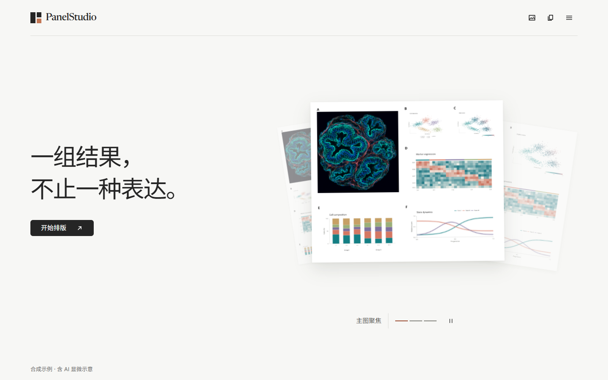

# PanelStudio

[中文](README.zh-CN.md)

PanelStudio is a local or self-hosted editor for multi-panel scientific figures. You import drawings you already made, the app proposes a layout and adds panel labels, and you export an SVG you can keep editing in Adobe Illustrator.

**Version 0.2.0** supports continuous refinement of an unapplied draft, comparison with its original revision, and acceptance or undo in one transaction. Existing schema-1 figures and project packages remain compatible. AI is optional.

## Refine a figure

1. Import up to eight existing panels and choose a layout.
2. Ask for changes to the full figure or a frozen selection. Keep refining the same draft, answer clarification questions, compare original and draft, then apply. You can edit while a proposal is being generated.
3. Drag individual labels, rigid groups or selected panels. Reorder the panel list to change lettering. Arrange two or three selected units into a row, preserving their sizes or using a common width or height.
4. Export editable SVG. The editor uses the bundled Noto faces to measure label ink and keeps text, supported vectors and raster images editable in their respective forms.



The homepage at `/` shows three layouts of the same scientific figure. It advances every five seconds and supports manual selection and pausing. Open **Gallery and demo** in the header for four editable examples, the recorded editing sequence and its SVG download. **Start arranging** opens `/app` to create or resume a figure. Returning home preserves the editing view and unsent AI input. Interface text uses 13, 15, 24 and 56 px. Figure labels use the document’s own typography.


Layout candidates now occupy the right inspector without shrinking the canvas. The inspector includes single-panel labels and common multi-selection typography; AI presents structured changes and collapsed history. Export identifies the saved revision and selects SVG, PNG or a project package. Existing reference layouts, publication briefs, provider settings and continuous draft refinement remain available.

[Homepage and workspace recording](docs/demo/first-pass.mp4) · [Design system](docs/editorial-design-system.md) · [Earlier implementation and regression evidence](docs/editorial-implementation.md) · [Four original synthetic examples](examples/showcase/)

Use **Reference & preferences** to upload a reference figure, describe your preferred composition, or combine both. Review the detected regions and adjust the emphasis, pairings, canvas shape and panel gap before previewing candidates. Image analysis runs in the browser. See the [six-panel comparison and editable files](examples/reference-preferences/).

The latest native Illustrator run passed 136/156 direct-open checks; the remaining checks concern substituted label fonts. CJK restoration passed 31/31, while four other restoration cases stopped because this instance lacked the requested Latin Noto faces. This is separate from browser/export regression and from the historical fully provisioned-font run. See the [current native results and prerequisite](docs/editorial-implementation.md#illustrator单独实机检查尚有字体环境项).

## Run

Node.js 22.12 or newer, pnpm 10.33.4.

```bash
pnpm install --frozen-lockfile
pnpm --filter @panelstudio/server exec node start.mjs
```

In a second terminal:

```bash
pnpm --filter @panelstudio/web dev
```

Open `http://127.0.0.1:5173`. Full notes, including the data directory and `master.key`, are in [`docs/install.md`](docs/install.md).

The default data directory is `$HOME/.panelstudio`. `master.key` is created there when you save a model secret. It must never be committed.

The project menu opens another project on this server, soft-deletes the current one, or restores a deleted one. A deleted project keeps its files and history, rejects new edits, and cancels work that had not finished. The route audit is [`docs/v0.1-gap-close.md`](docs/v0.1-gap-close.md).

## Formats and limits

PNG, JPEG, WebP, and a documented subset of SVG. At most 8 panels in a project. Editable SVG keeps vectors and label text; it does not turn type into outlines. PDF, EPS, native `.ai`, and outline export are outside the supported formats.

Details: [`docs/format-support.md`](docs/format-support.md).

## Example

[`examples/synthetic-six/`](examples/synthetic-six/) is an original six-panel figure (MIT), with source drawings and a `.figurezip`.

## More

- [Test record](docs/test-record.md)
- [Illustrator checklist](docs/illustrator-compatibility.md)
- [Licenses, including the Noto OFL](docs/licenses.md)
- [Phase 6 notes](docs/phase-6-decisions.md)
- [v0.1 route audit](docs/v0.1-gap-close.md)
