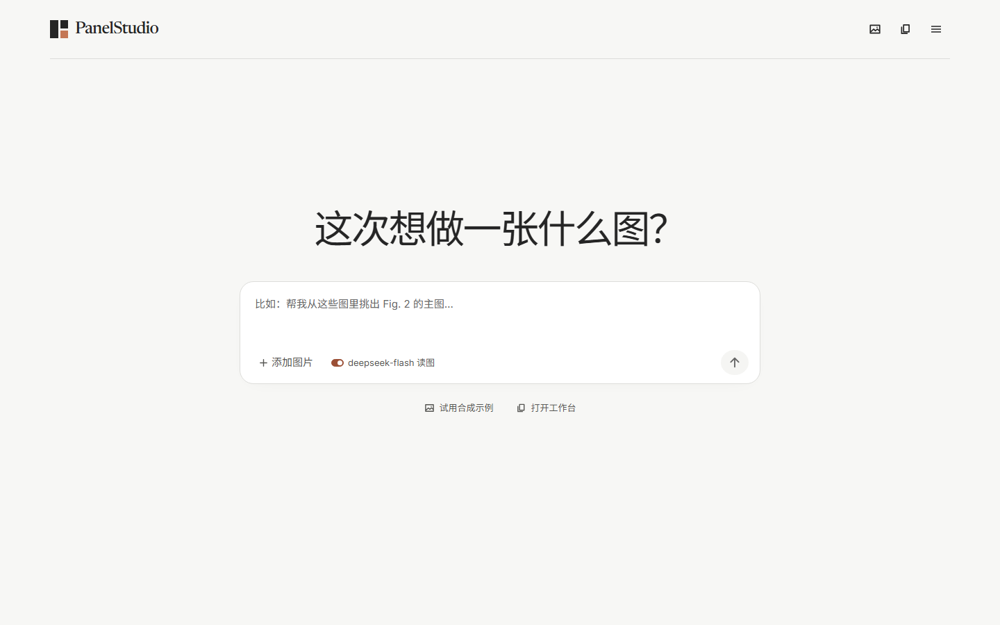
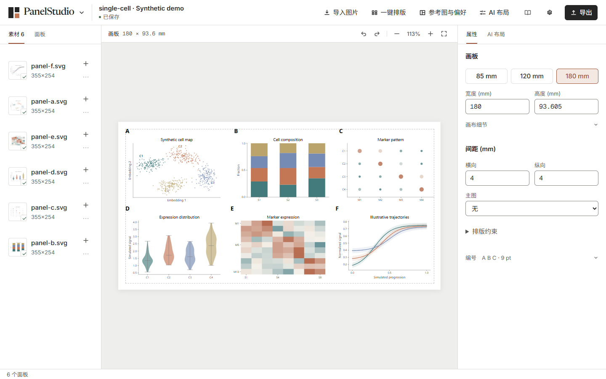

# PanelStudio

[中文](README.zh-CN.md)

PanelStudio is a local or self-hosted editor for multi-panel scientific figures. You import drawings you already made, the app proposes a layout and adds panel labels, and you export an SVG you can keep editing in Adobe Illustrator.

**Development preview · 0.2.0.** Run it locally in a browser with no PanelStudio account. Import, manual layout, editing and export work without an API key.

## Make a figure

Start on the homepage with a message, images, or both. Attach, paste or drop panels, remove any unwanted attachments, then send. When the goal is unclear, PanelStudio asks one question with suggested answers and space for your own answer. The conversation carries into panel selection and layout. For a known arrangement, send “A and B side by side, C below, 85 mm wide.” Keep refining the draft on the canvas by talking, dragging or entering precise dimensions.

If the layout is undecided, give the target journal or the point your reader should notice first. With a visual model connected, PanelStudio can suggest which panels belong in the main figure and which belong in the supplement. Try changing the focus to “Show how closely the two methods agree.” If a supplemental panel offers more direct evidence, the model asks whether to bring it into the main figure. You can locate a changed panel from the edit summary and undo the edit in one step.

Local reading extracts SVG text, runs English and Simplified Chinese OCR on pixels and suggests a figure type without an API key. Connect an image-capable model in **Settings → AI connection** to send readable images, extracted text and preliminary types with your request. The switch beside the input turns this off. The model reads each image before checking its filename. A clear discrepancy opens one question beside the image. You can enlarge it, use what it shows, follow the filename, or give your own interpretation. The project remembers your choice and resumes the request. Export an editable SVG, a PNG, or the project package.

To inspect the local reading separately, run `node apps/server/inspect-figures.mjs --out reading-output plot.svg panel.png` from the repository root. The output contains reading previews and `evidence.json`.



The homepage at `/` accepts your own figures or opens a three-image rehearsal. The gallery shows three layouts of the same scientific figure. It advances every five seconds and supports manual selection and pausing. Open **Gallery and demo** in the header for four editable examples, the recorded editing sequence and its SVG download. **Open workspace** opens `/app` to create or resume a figure. Returning home preserves the editing view and unsent AI input. Interface text uses 13, 15, 24 and 56 px. Figure labels use the document’s own typography.



Layout candidates now occupy the right inspector without shrinking the canvas. The inspector includes single-panel labels and common multi-selection typography; AI presents structured changes and collapsed history. Export identifies the saved revision and selects SVG, PNG or a project package. Existing reference layouts, publication briefs, provider settings and continuous draft refinement remain available.

[Homepage and workspace recording](docs/demo/first-pass.mp4) · [Design system](docs/editorial-design-system.md) · [Earlier implementation and regression evidence](docs/editorial-implementation.md) · [Four original synthetic examples](examples/showcase/)

Use **Reference & preferences** to upload a reference figure, describe your preferred composition, or combine both. Review the detected regions and adjust the emphasis, pairings, canvas shape and panel gap before previewing candidates. Image analysis runs in the browser. See the [six-panel comparison and editable files](examples/reference-preferences/).

The latest native Illustrator run passed 136/156 direct-open checks; the remaining checks concern substituted label fonts. CJK restoration passed 31/31, while four other restoration cases stopped because this instance lacked the requested Latin Noto faces. This is separate from browser/export regression and from the historical fully provisioned-font run. See the [current native results and prerequisite](docs/editorial-implementation.md#illustrator单独实机检查尚有字体环境项).

## Run

Node.js 22.12 or newer, pnpm 10.33.4.

```bash
git clone --branch design/editorial-studio https://github.com/lxhcxyjpl-dotcom/PanelStudio.git
cd PanelStudio
pnpm install --frozen-lockfile
pnpm --filter @panelstudio/server exec node start.mjs
```

In a second terminal:

```bash
pnpm --filter @panelstudio/web dev
```

Open `http://127.0.0.1:5173`. Full notes, including the data directory and `master.key`, are in [`docs/install.md`](docs/install.md).

The default data directory is `$HOME/.panelstudio`. `master.key` is created there when you save a model secret. It must never be committed.

The project menu opens another project on this server, soft-deletes the current one, or restores a deleted one. A deleted project keeps its files and history, rejects new edits, and cancels work that had not finished. The route audit is [`docs/v0.1-gap-close.md`](docs/v0.1-gap-close.md).

## Formats and limits

Supports PNG, JPEG, WebP, and the documented SVG subset. A project can hold up to 32 assets and use up to 32 panels. SVG export keeps vector artwork and panel labels editable and embeds raster images as raster artwork.

Details: [`docs/format-support.md`](docs/format-support.md).

## Example

[`examples/synthetic-six/`](examples/synthetic-six/) is an original six-panel figure (MIT), with source drawings and a `.figurezip`.

## More

- [Test record](docs/test-record.md)
- [Illustrator checklist](docs/illustrator-compatibility.md)
- [Licenses, including the Noto OFL](docs/licenses.md)
- [Phase 6 notes](docs/phase-6-decisions.md)
- [v0.1 route audit](docs/v0.1-gap-close.md)
