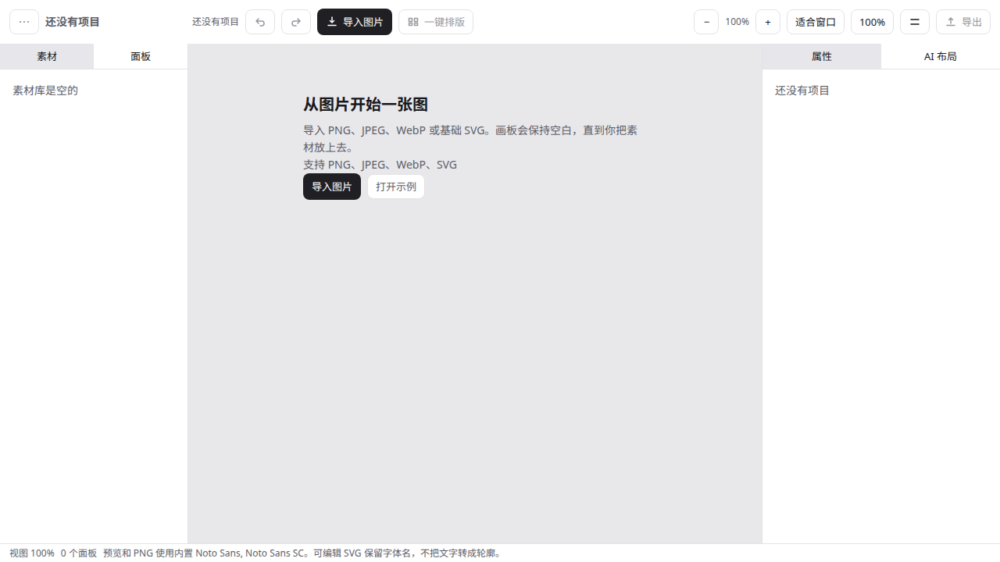
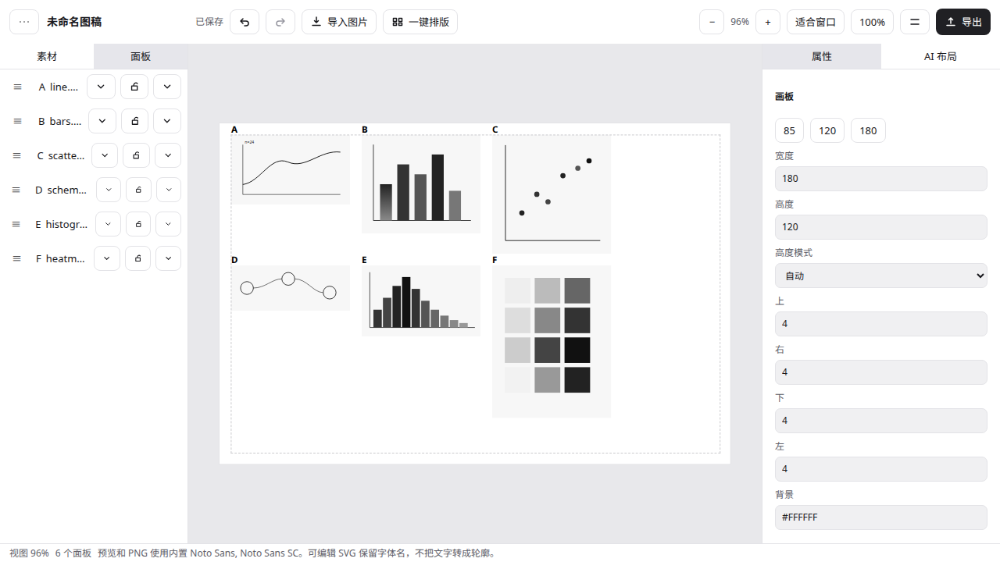
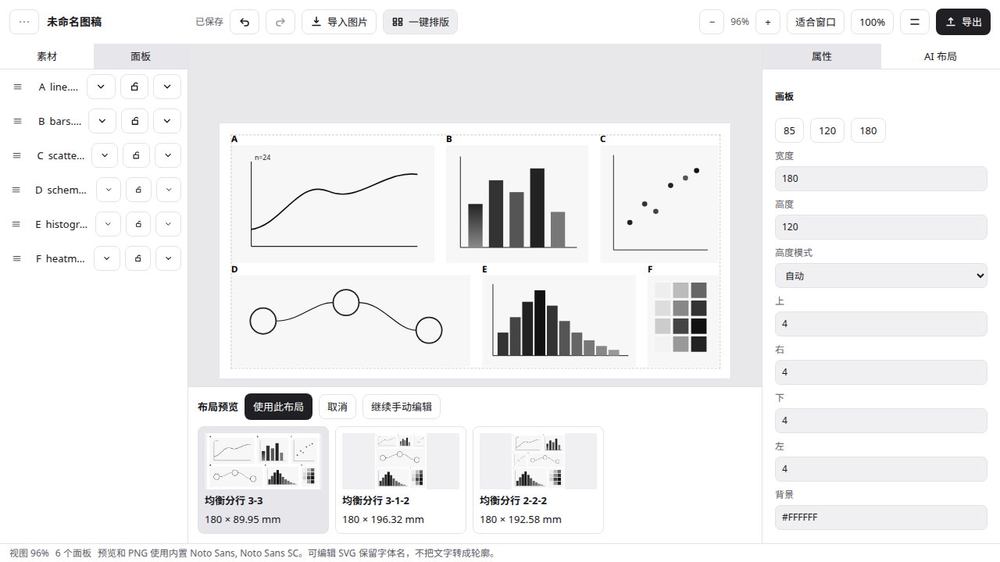
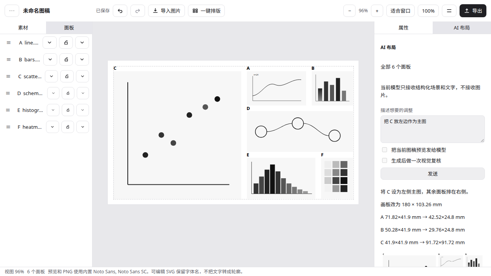
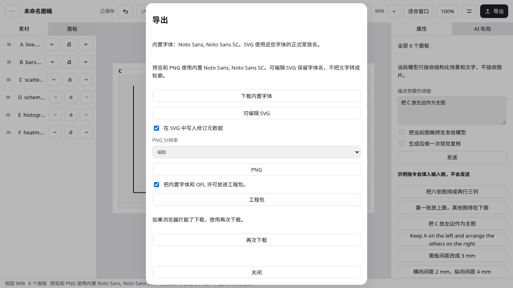

# PanelStudio

[中文](README.zh-CN.md)

PanelStudio is a local or self-hosted editor for multi-panel scientific figures. You import drawings you already made, the app proposes a layout and adds panel labels, and you export an SVG you can keep editing in Adobe Illustrator.

The normative handbook is [`docs/PanelStudio-spec-v0.1.md`](docs/PanelStudio-spec-v0.1.md). This repository is v0.1.0. AI is optional: import, layout, editing, and export work with no model configured.

## Flow

Import images → auto layout → adjust with one sentence, or with the mouse → export SVG → keep editing in Illustrator.











Those stills are from the running app. A Playwright capture of the same in-app states is [`docs/demo/in-app-walkthrough.webm`](docs/demo/in-app-walkthrough.webm). It does not include Illustrator. The sentence in that capture is answered by a local stand-in, not a hosted model. The script is [`docs/demo.md`](docs/demo.md).

## Run

Node.js 22.12 or newer, pnpm 10.33.4.

```bash
pnpm install --frozen-lockfile
pnpm --filter @panelstudio/server exec node start.mjs
```

In a second terminal:

```bash
pnpm --filter @panelstudio/web dev
```

Open `http://127.0.0.1:5173`. Full notes, including the data directory and `master.key`, are in [`docs/install.md`](docs/install.md).

The default data directory is `$HOME/.panelstudio`. `master.key` is created there when you save a model secret. It must never be committed.

## Formats and limits

PNG, JPEG, WebP, and a documented subset of SVG. At most 8 panels in a project. Editable SVG keeps vectors and label text; it does not turn type into outlines. PDF, EPS, native `.ai`, and outline export are out of scope for v0.1.

Details: [`docs/format-support.md`](docs/format-support.md).

## Example

[`examples/synthetic-six/`](examples/synthetic-six/) is an original six-panel figure (MIT), with source drawings and a `.figurezip`.

## More

- [Test record](docs/test-record.md)
- [Illustrator checklist](docs/illustrator-compatibility.md) — every row needs a manual check
- [Licenses, including the Noto OFL](docs/licenses.md)
- [Phase 6 notes](docs/phase-6-decisions.md)
