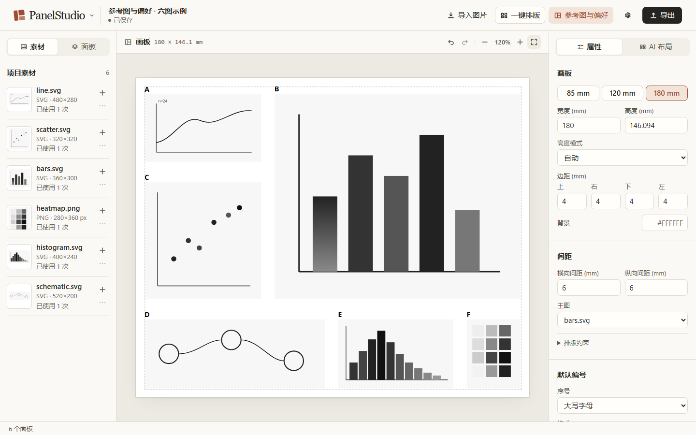

# PanelStudio

[English](README.md)

PanelStudio 是一个本地或自部署的科研多面板排版编辑器。导入已经画好的子图，应用给出版式并加上面板编号，再导出可以在 Adobe Illustrator 里继续编辑的 SVG。

**当前版本为 0.2.0。** 支持在一份未应用的草案上连续精修、对照原稿、一次应用和一次撤销。现有 schema 1 项目和工程包可继续打开。AI 为可选功能。

## 精修流程

1. 导入最多八张已绘好的子图，生成初始排版。
2. 在 AI 面板选择全图或选中对象。同一份草案可以继续调整，也可以回答澄清问题。切换原稿与草案查看累计变化。生成期间可以继续手动编辑。
3. 应用草案后，直接移动编号、拖动整组或多选对象，或在面板列表中调整编号顺序。选中两个或三个完整单元，可在指定区域内按原尺寸、等宽或等高排成一行。
4. 导出可编辑 SVG。图块、支持的原生路径和文字、栅格素材保持独立。编号的屏幕预览和布局使用内置 Noto 字体的实际度量。



首页可先描述图稿目标、导入图片、打开工程包，或继续最近编辑的项目。右上角书本按钮提供三步「快速上手」，首次访问也会显示入口。编辑时可从左上角 **PanelStudio → 返回工作台首页** 切回。[对话交互与新手引导](docs/v0.3-conversation-ui.md) · [参考图与偏好窗口](docs/screenshots/studio-reference.webp)

[可复现的六图工程](examples/refinement-six/) · [实机界面录像](docs/demo/v0.2-refinement.webm) · [本机 Illustrator 验收记录](docs/illustrator-compatibility.md)

工具栏的 **参考图与偏好** 支持上传期刊组图、写下构图要求，或同时使用两者。可以指定主图、相邻对比、画布方向与面板间距，再预览候选。参考图在浏览器内识别，识别框可手动调整。参见[六图排版对照、工程包与 Illustrator 样稿](examples/reference-preferences/)。

v0.3 开发中的 **按内容排版** 支持填写目标期刊、研究领域、一句话主张和排版偏好。配置支持图片输入的 API 后，模型可查看独立子图，结合相关论文版式与用户已采用的布局生成草案。参见[使用方式与验证范围](docs/v0.3-content-layout.md)。

在 **设置 → AI 连接** 中选择服务商，填写服务地址、模型与 API 密钥，可一次保存并测试。支持 DeepSeek、OpenAI、OpenRouter、Ollama 快捷项及自定义 Chat Completions 兼容服务；协议细节与本地地址选项收在高级设置中。[连接方式、内页调整与验证范围](docs/v0.3-connection-ui.md)。

在本机 Illustrator 30.7 中，中文混排样稿直接打开时出现字重替换。若遇到同一情况，可运行导出字体包中的编号字体还原脚本，再保存为 .ai。五组样稿的复测结果见上方实机验收记录。

## 运行

需要 Node.js 22.12 或更新，以及 pnpm 10.33.4。

```bash
pnpm install --frozen-lockfile
pnpm --filter @panelstudio/server exec node start.mjs
```

另一个终端：

```bash
pnpm --filter @panelstudio/web dev
```

打开 `http://127.0.0.1:5173`。数据目录、`master.key` 和自部署说明在 [`docs/install.md`](docs/install.md)。

数据目录默认是 `$HOME/.panelstudio`。保存模型密钥时会在那里生成 `master.key`，在 POSIX 系统上使用 `0600` 权限。不要把这个文件提交到仓库。

项目菜单可以打开这台服务上的其他项目，软删除当前项目，或恢复已删除的项目。删除后素材和历史还在，新的修改会被拒绝，未完成的任务会被取消。路由对照见 [`docs/v0.1-gap-close.md`](docs/v0.1-gap-close.md)。

## 格式与限制

支持 PNG、JPEG、WebP，以及文档列出的 SVG 子集。一个项目最多 8 个面板。可编辑 SVG 保留矢量和编号文字，不把文字转成轮廓。当前版本不导入 PDF、EPS 或原生 `.ai`，也不提供转曲导出。

详见 [`docs/format-support.md`](docs/format-support.md)。

## 示例

[`examples/synthetic-six/`](examples/synthetic-six/) 是原创的六面板图（MIT），带源文件和 `.figurezip`。

## 其他

- [测试记录](docs/test-record.md)
- [Illustrator 对照表](docs/illustrator-compatibility.md)
- [依赖与字体许可](docs/licenses.md)
- [v0.2 实施决定](docs/v0.2-decisions.md)
- [v0.1 路由对照](docs/v0.1-gap-close.md)
