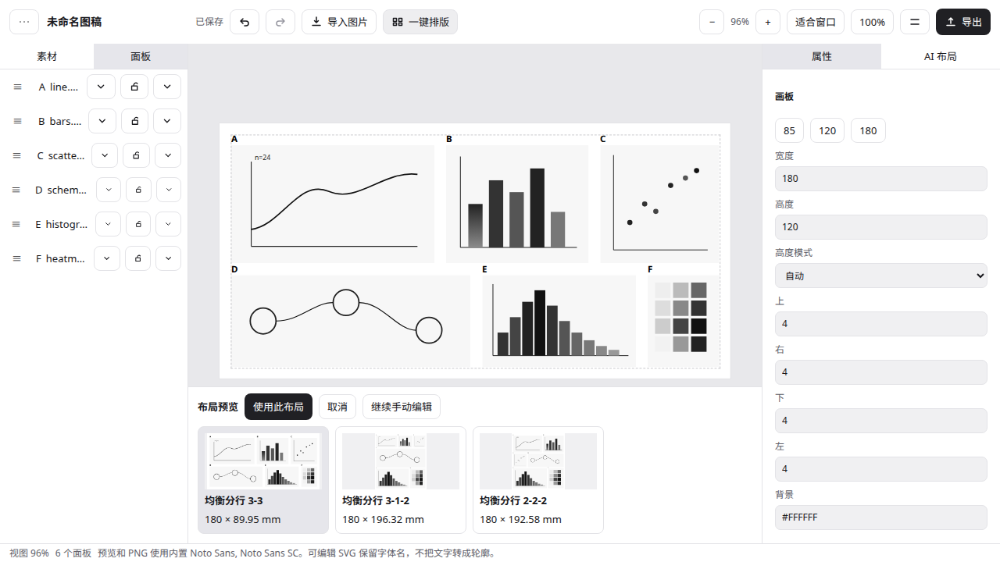

# PanelStudio

[English](README.md)

PanelStudio 是一个本地科研组图工具。导入已经画好的子图，在画布上比较版式、微调尺寸和面板编号，再导出可在 Adobe Illustrator 里继续编辑的 SVG。

**最新开发预览** · [PanelStudio 0.2.0](https://github.com/lxhcxyjpl-dotcom/PanelStudio/tree/design/editorial-studio) 支持模型读图、挑选正文和补图、对话改稿与一键撤销。下方启动步骤适用于默认分支 v0.1.0。

在本机启动后，用浏览器打开即可使用，无需注册账号。基础导入、排版、编辑和导出无需 API Key。想用自然语言描述排版要求，可以在 AI 设置里接入兼容模型。



## 本地运行

需要 Node.js 22.12 或更新版本，以及 pnpm 10.33.4。在第一个终端下载源码、安装依赖并启动后端。

```bash
git clone https://github.com/lxhcxyjpl-dotcom/PanelStudio.git
cd PanelStudio
pnpm install --frozen-lockfile
pnpm --filter @panelstudio/server exec node start.mjs
```

在 `PanelStudio` 目录打开第二个终端，启动网页。

```bash
pnpm --filter @panelstudio/web dev
```

保持两个终端运行，打开[本机工作台](http://127.0.0.1:5173)。项目和图片默认保存在后端所在电脑的 `$HOME/.panelstudio`。更多安装、数据目录和自部署细节见[安装说明](docs/install.md)。

## 格式与限制

支持 PNG、JPEG、WebP，以及文档列出的 SVG 子集。一个项目最多 8 个面板。可编辑 SVG 保留矢量和编号文字，不把文字转成轮廓。v0.1 不导入 PDF、EPS 或原生 `.ai`，也不提供转曲导出。

详见 [`docs/format-support.md`](docs/format-support.md)。

## 示例

可以先用[原创六面板示例](examples/synthetic-six/)（MIT），其中有源图和 `.figurezip` 工程包。[演示录像](docs/demo/in-app-walkthrough.webm)展示导入、排版和 SVG 导出，示例排版指令使用本地测试模型。

## 其他

- [测试记录](docs/test-record.md)
- [Illustrator 兼容性检查表](docs/illustrator-compatibility.md)
- [依赖与字体许可](docs/licenses.md)
- [v0.1 手册](docs/PanelStudio-spec-v0.1.md)
- [阶段 6 记录](docs/phase-6-decisions.md)
- [v0.1 路由对照](docs/v0.1-gap-close.md)
