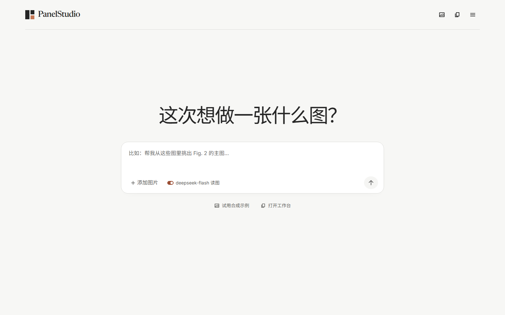
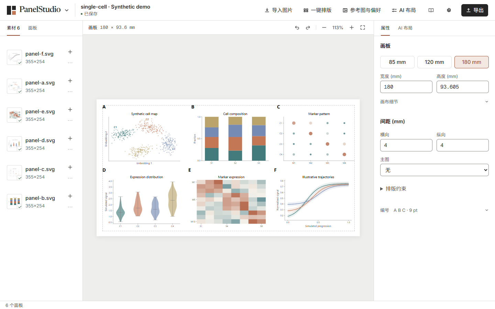

# PanelStudio

[English](README.md)

PanelStudio 是一个本地或自部署的科研多面板排版编辑器。导入已经画好的子图，应用给出版式并加上面板编号，再导出可以在 Adobe Illustrator 里继续编辑的 SVG。

**开发预览版 · 0.2.0。** 在本机启动后用浏览器打开，无需注册账号。导入、手动排版、编辑和导出无需配置 API Key。

## 从素材到图稿

在首页可以先说想法，也可以添加、粘贴或拖入图片，检查附件后一起发送。拿不准该选哪些图时，PanelStudio 会问一个具体问题，点选答案或直接写自己的想法即可继续。上传后，讨论过的选图目标和尺寸会带入第一稿。已有排法时可直接说「A 和 B 并排，C 放在下面，整张宽 85 mm」。在画布上可以继续说「把 B 缩小 10%」，也可以拖动面板或输入精确尺寸。

还没想好怎么排，可以告诉软件目标期刊，或这张图想让读者先看到什么。接入视觉模型后，软件可以按内容挑出正文图和补图。试着说「我想重点讲两种方法的一致性」。如果补图能给出更直接的证据，模型会询问是否把它加入正文。改完可以点反馈定位面板，也可以一次撤销。

无需 API key 即可本地提取 SVG 文字，对像素图做中英文文字识别，并初判图型。在「设置 → AI 连接」接入支持图片的模型后，发送要求时会把清晰图像、提取文字和初判一起交给模型。输入框旁的开关可以关闭。模型先看图，再核对文件名。两者有明确冲突时，可以查看大图，选「按图中内容」「按文件名」或自己说明。工程会记住确认并继续刚才的要求。稿件可导出为可编辑 SVG、PNG 或工程包。

若想单独核对本地识图，从仓库根目录运行 `node apps/server/inspect-figures.mjs --out reading-output plot.svg panel.png`。目录里会保存每张图的读图预览和 `evidence.json`。



首页 `/` 可直接带图起稿。「作品与演示」里的轮播与回放使用实际导出的示例。`/app` 继续最近项目，`/app/:projectId` 直接打开指定图稿。返回首页会保留编辑视图和未发送的 AI 输入。界面使用 **13 / 15 / 24 / 56 px** 四档字号，科研图稿使用文档自己的字号。



布局候选移到右侧，切换时不压缩画布。检查器支持单图几何与编号、多选统一字体/字号/字重/颜色；AI 展示结构化修改和折叠历史。导出窗口明确显示已保存修订号，可选择 SVG、PNG 或工程包。原有参考图、排版目标、服务连接和连续草案精修功能保留。

[首页与工作台实际运行录像](docs/demo/first-pass.mp4) · [设计系统](docs/editorial-design-system.md) · [上一阶段交付与回归记录](docs/editorial-implementation.md) · [四类原创合成示例](examples/showcase/)

工具栏的 **参考图与偏好** 支持上传期刊组图、写下构图要求，或同时使用两者。可以指定主图、相邻对比、画布方向与面板间距，再预览候选。参考图在浏览器内识别，识别框可手动调整。参见[六图排版对照、工程包与 Illustrator 样稿](examples/reference-preferences/)。

v0.3 开发中的 **按内容排版** 支持填写目标期刊、研究领域、一句话主张和排版偏好。配置支持图片输入的 API 后，模型可查看独立子图，结合相关论文版式与用户已采用的布局生成草案。参见[使用方式与验证范围](docs/v0.3-content-layout.md)。

在 **设置 → AI 连接** 中选择服务商，填写服务地址、模型与 API 密钥，可一次保存并测试。支持 DeepSeek、OpenAI、OpenRouter、Ollama 快捷项及自定义 Chat Completions 兼容服务；协议细节与本地地址选项收在高级设置中。[连接方式、内页调整与验证范围](docs/v0.3-connection-ui.md)。

本次 Illustrator 30.7 实机直接打开通过 136/156 项，剩余项涉及编号字体替换；中文样稿经还原为 31/31，其余四组还原因当前实例缺少拉丁 Noto 字面而停止。浏览器与导出回归和原生字体环境分开报告，详见[本次实测记录](docs/editorial-implementation.md)。

## 运行

需要 Node.js 22.12 或更新，以及 pnpm 10.33.4。

```bash
git clone --branch design/editorial-studio https://github.com/lxhcxyjpl-dotcom/PanelStudio.git
cd PanelStudio
pnpm install --frozen-lockfile
pnpm --filter @panelstudio/server exec node start.mjs
```

另一个终端：

```bash
pnpm --filter @panelstudio/web dev
```

打开 `http://127.0.0.1:5173`。数据目录、`master.key` 和自部署说明在 [`docs/install.md`](docs/install.md)。

数据目录默认是 `$HOME/.panelstudio`。保存模型密钥时会在那里生成 `master.key`，在 POSIX 系统上使用 `0600` 权限。不要把这个文件提交到仓库。

项目菜单可以打开这台服务上的其他项目，软删除当前项目，或恢复已删除的项目。删除后素材和历史还在，新的修改会被拒绝，未完成的任务会被取消。路由对照见 [`docs/v0.1-gap-close.md`](docs/v0.1-gap-close.md)。

## 格式与限制

支持 PNG、JPEG、WebP 以及文档列出的 SVG 子集。项目可保存 32 份素材，图稿最多使用 32 个面板。导出的 SVG 保留可编辑的矢量和编号文字，像素图以原有的栅格形式嵌入。

详见 [`docs/format-support.md`](docs/format-support.md)。

## 示例

[`examples/synthetic-six/`](examples/synthetic-six/) 是原创的六面板图（MIT），带源文件和 `.figurezip`。

## 其他

- [测试记录](docs/test-record.md)
- [Illustrator 对照表](docs/illustrator-compatibility.md)
- [依赖与字体许可](docs/licenses.md)
- [v0.2 实施决定](docs/v0.2-decisions.md)
- [v0.1 路由对照](docs/v0.1-gap-close.md)
