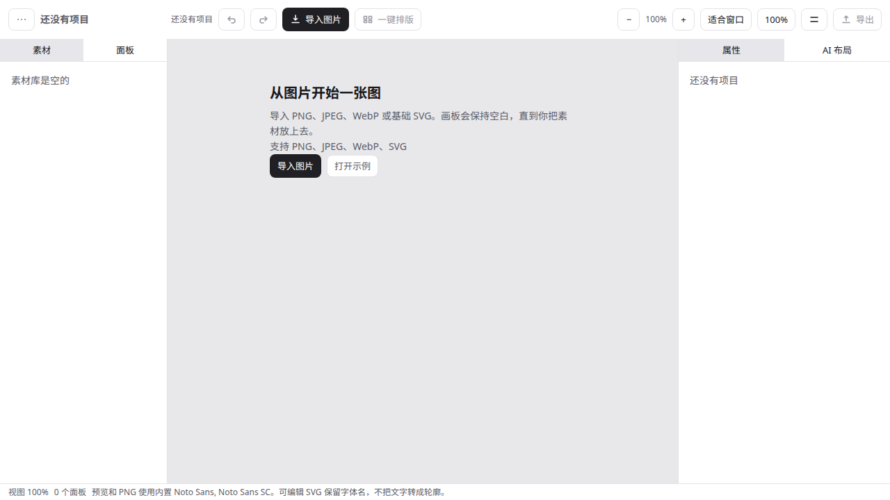
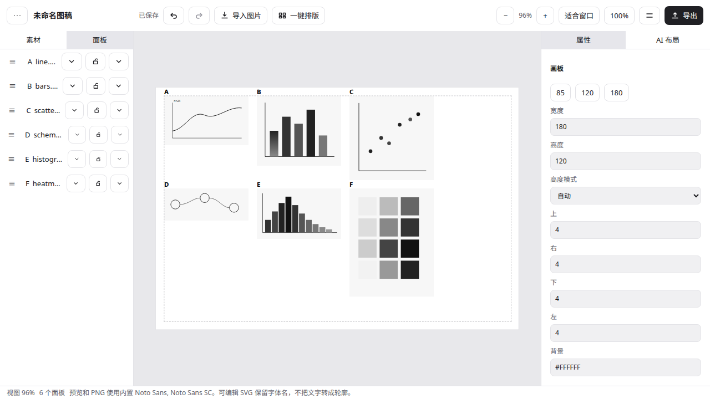
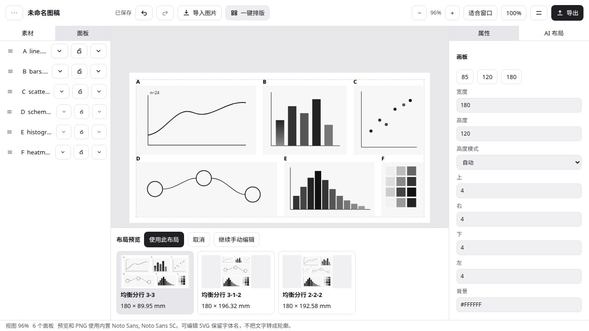
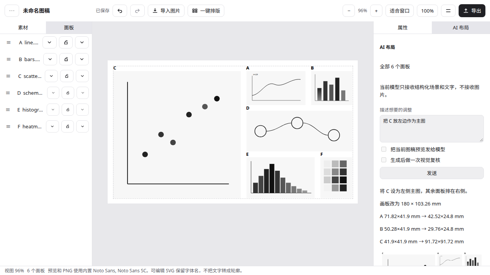
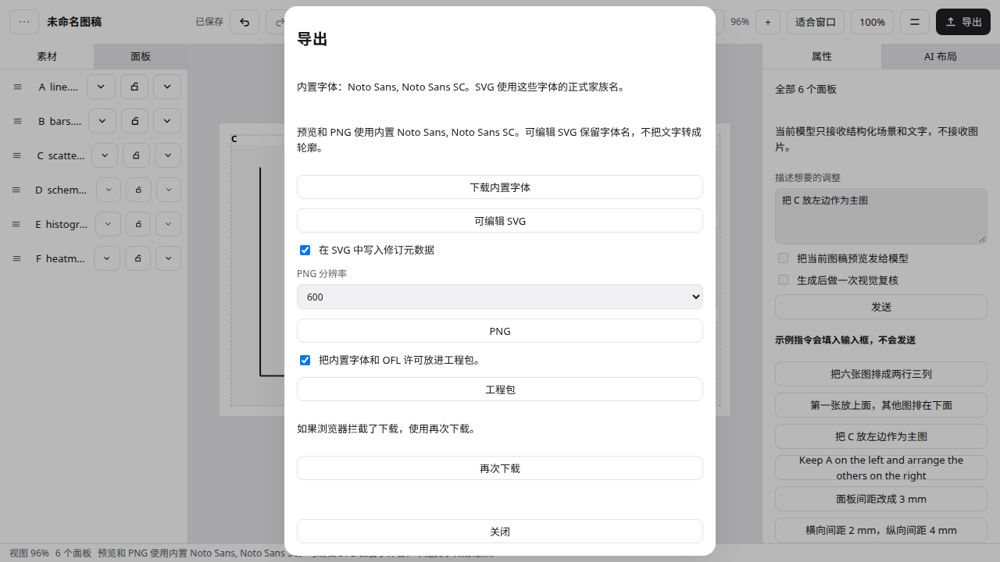

# PanelStudio

[English](README.md)

PanelStudio 是一个本地或自部署的科研多面板排版编辑器。导入已经画好的子图，应用给出版式并加上面板编号，再导出可以在 Adobe Illustrator 里继续编辑的 SVG。

规范正文是 [`docs/PanelStudio-spec-v0.1.md`](docs/PanelStudio-spec-v0.1.md)。当前版本是 v0.1.0。AI 是可选的：不配置模型，导入、排版、编辑和导出仍然可用。

## 核心流程

导入图片 → 一键排版 → 用一句话或鼠标调整 → 导出 SVG → 在 Illustrator 里继续改。











这些截图来自正在运行的应用。同一段应用内流程的 Playwright 录像是 [`docs/demo/in-app-walkthrough.webm`](docs/demo/in-app-walkthrough.webm)。录像里没有 Illustrator。那一句调整由本地语料替身回答，不是托管模型。讲解稿在 [`docs/demo.md`](docs/demo.md)。Illustrator 里改编号和曲线需要人来录。

## 运行

需要 Node.js 22.12 或更新，以及 pnpm 10.33.4。

```bash
pnpm install --frozen-lockfile
pnpm --filter @panelstudio/server exec node start.mjs
```

另一个终端：

```bash
pnpm --filter @panelstudio/web dev
```

打开 `http://127.0.0.1:5173`。数据目录、`master.key` 和自部署说明在 [`docs/install.md`](docs/install.md)。

数据目录默认是 `$HOME/.panelstudio`。保存模型密钥时会在那里生成 `master.key`，权限 `0600`。不要把这个文件提交到仓库。

## 格式与限制

支持 PNG、JPEG、WebP，以及文档列出的 SVG 子集。一个项目最多 8 个面板。可编辑 SVG 保留矢量和编号文字，不把文字转成轮廓。v0.1 不导入 PDF、EPS 或原生 `.ai`，也不提供转曲导出。

详见 [`docs/format-support.md`](docs/format-support.md)。

## 示例

[`examples/synthetic-six/`](examples/synthetic-six/) 是原创的六面板图（MIT），带源文件和 `.figurezip`。

## 其他

- [测试记录](docs/test-record.md)
- [Illustrator 对照表](docs/illustrator-compatibility.md)：每一行都是 needs manual check
- [依赖与字体许可](docs/licenses.md)
- [阶段 6 记录](docs/phase-6-decisions.md)
