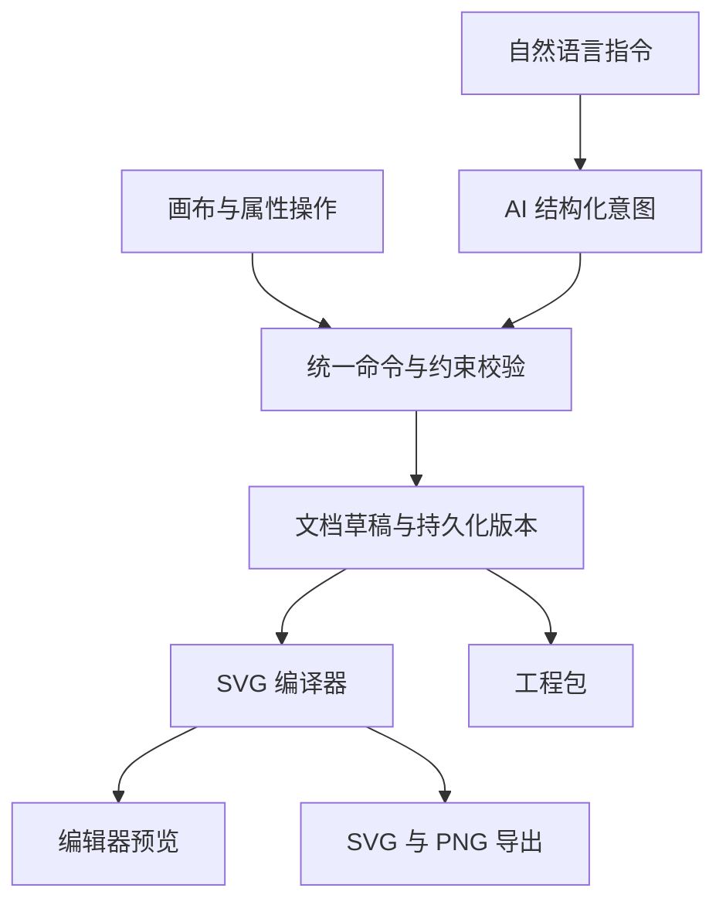

# 科研多面板排版编辑器开发规范

**文档版本：v0.1**

**项目暂定名：PanelStudio**

**产品形态：本地或自部署的 Web 应用**

**主要后续编辑工具：Adobe Illustrator**

以下字段、尺寸、默认值、限制和验收门槛，均为本项目的设计决策。实现时应以本规范为统一依据。

## 产品定位（规范前置说明）

项目确定为：科研多面板排版编辑器，以可编辑 SVG 为核心交付格式，传统排版引擎负责可靠性，AI 负责理解修改意图。

前端按桌面创作工具来设计：画板是视觉中心，操作直接、反馈清楚，浅色和深色都采用黑白灰体系。苹果生态值得借鉴的是层级、留白、材质和操作反馈；具体颜色、尺寸和动效参数以本文给出的明确值为准。

“自定义语言”按三部分一起覆盖：

- 界面中英文及可导入的语言包。
- 常见自然语言修改指令。
- 可自定义的编号、字体、颜色与排版参数。

## 给实现者的执行要求

请按照本规范实现 PanelStudio v0.1。先阅读全部规格，建立共享 Schema、命令系统和 API 合同，再按阶段完成。

项目的核心交付是：科研子图的确定性排版、可撤销的自然语言修改，以及可继续在 Illustrator 编辑的 SVG。

所有图稿修改必须通过统一领域命令；前端、AI、自动布局和导出使用同一文档模型。

优先完成“导入素材 → 新增编号 → 导出 SVG → Illustrator 实机检查”的完整链路，再扩展界面与 AI。

前端严格使用本文设计变量、尺寸、交互状态与动效参数。完整实现空状态、错误、保存失败、候选过期和撤销恢复，所有显示出来的按钮都必须有真实行为。

不增加本文未纳入 v0.1 的功能。发现规格冲突时，先指出冲突与建议，不能悄悄修改数据语义。

每个阶段提交可运行成果、已完成项目、实际验证结果和剩余问题。测试重点放在几何、素材保真、版本一致性、导出可编辑性与主要用户流程。

只有在实际执行对应检查后，才把该验收项标为完成。

## 一、产品目标与首版边界

### 1.1 产品的一句话定义

用户导入若干已有科研子图，应用自动提供合适的组合版式、添加面板编号，支持手动或自然语言调整，最后导出可继续在 Illustrator 中编辑的 SVG。

完整操作链：

> 导入子图 → 获得布局候选 → 调整位置、尺寸和编号 → 用自然语言精修 → 导出 SVG → 在 Illustrator 中继续编辑。

Illustrator 官方支持通过“文件 → 打开”导入 SVG。实际交付应采用标准 SVG，用户打开后可以另存为 `.ai`；本项目的兼容性需要通过后文规定的 Illustrator 实机验收。[Illustrator](https://helpx.adobe.com/illustrator/desktop/get-started/learn-the-basics/supported-file-formats-in-illustrator.html)

### 1.2 首版必须完成的能力

| 模块 | v0.1 范围 |
|---|---|
| 项目 | 创建、打开、重命名、自动保存、软删除、恢复 |
| 画板 | 单页画板，毫米尺寸，可选择固定高度或自动排版时计算高度 |
| 素材 | PNG、JPEG、WebP、受支持的 SVG |
| 面板数量 | 一个项目最多 8 个面板；自动排版适用于 2–8 个面板 |
| 自动排版 | 返回最多 3 个不同的有效候选 |
| 手动编辑 | 选择、多选、拖动、等比例缩放、裁剪、对齐、分布、锁定 |
| 编号 | A/B/C、a/b/c、1/2/3；括号格式；自定义短文本 |
| 分组 | 单层编辑组，共同移动、对齐、锁定、解组 |
| AI | 用户自行配置模型接口，自然语言生成可预览的修改 |
| 历史 | 一次操作对应一次撤销；刷新和服务重启后仍保留历史 |
| 导出 | SVG、PNG、可重新打开的工程包 |
| 前端 | 完整桌面编辑器、浅色/深色主题、中英文 |
| 交付 | 可运行应用、API 文档、测试样例、Illustrator 兼容性记录 |

### 1.3 后续版本再扩展的能力

以下功能不进入 v0.1 开发任务：

- PDF、EPS、原生 `.ai` 的导入。
- 在网页里编辑原 SVG 的路径节点。
- 从截图还原曲线、坐标轴和文字。
- 自动修改图内数据、坐标轴范围或统计结果。
- 通用箭头、富文本说明、流程图绘制。
- 多画板、多人协作、账户、订阅付费。
- 字体转轮廓导出。
- 科学物理尺度自动标定。
- MCP Server、Skill、桌面安装包。

这些扩展应复用首版的文档模型与命令引擎，不能分别建设另一套编辑逻辑。

### 1.4 “可编辑”的明确含义

| 输入或新增内容 | 导出后的预期 |
|---|---|
| PNG、JPEG、WebP | 独立的嵌入图片对象，可移动、缩放、调整裁剪 |
| 受支持 SVG 中的 path、line、rect 等 | 保留为原生矢量元素 |
| 受支持 SVG 中原本存在的 text/tspan | 保留为文字，受目标机器字体可用性影响 |
| 输入中已经转为路径的文字 | 继续保留为路径 |
| 本工具新加的 A/B/C 编号 | 原生文字，可用 Illustrator 文字工具修改 |
| 本工具的工程包 | 恢复素材、裁剪、布局、编号和编辑组 |

**首版最重要的交付标准：受支持的矢量输入不能在导出时被整张栅格化；新增编号必须保持为文字。**

# 二、系统架构与技术选型

## 2.1 固定技术路线

采用 TypeScript 全栈，减少前后端几何、字段和校验逻辑的分叉。

| 层级 | 选型 | 主要职责 |
|---|---|---|
| 前端 | React + TypeScript + Vite | 编辑器与交互 |
| 编辑画布 | 原生 SVG DOM | 面板、编号、裁剪、选择辅助层 |
| 客户端状态 | Zustand | 选中、工具、视图、草稿、预览 |
| 服务端数据请求 | TanStack Query | 项目、素材、任务、历史状态 |
| UI 基础交互 | Radix Primitives | Dialog、Popover、Menu、Tooltip 等 |
| 样式 | CSS Variables + CSS Modules | 统一主题和组件样式 |
| 国际化 | i18next + react-i18next | 中英文及扩展语言包 |
| 后端 | Node.js LTS + Fastify | API、任务、文件、模型调用 |
| 契约 | TypeBox + JSON Schema | 类型、校验、OpenAPI |
| 数据库 | SQLite | 项目、版本、任务、配置 |
| 大文件 | 本地文件存储 | 原件、规范化素材、缩略图、导出文件 |
| 栅格处理 | Sharp | 解码、方向规范化、缩略图 |
| SVG 转 PNG | `@resvg/resvg-js` | 预览和 PNG 导出 |
| 测试 | Vitest + Playwright | 几何、接口、编辑流程、视觉回归 |

Fastify 支持基于 JSON Schema 的请求校验与响应序列化，也提供 TypeBox 类型集成，适合让 API 与共享类型保持一致。[Fastify latest](https://fastify.dev/docs/latest/Reference/Validation-and-Serialization/)

`resvg-js` 提供 SVG 转 PNG 和字体加载能力；本项目只将其用于栅格预览与 PNG 输出，**可编辑 SVG 由自己的 SVG 编译模块生成**。[GitHub](https://github.com/thx/resvg-js)

依赖版本在开发阶段 0 确认并锁定。选用稳定版本、提交 lockfile，不使用浮动的 `latest` 作为可复现构建依据。

## 2.2 模块划分

建议采用 pnpm workspace，逻辑划分如下：

| 模块 | 内容 |
|---|---|
| `apps/web` | 编辑器界面 |
| `apps/server` | Fastify API、任务调度、文件存储 |
| `packages/contracts` | 所有公开 Schema、类型、错误码 |
| `packages/core` | 文档操作、编号、裁剪、几何校验 |
| `packages/layout` | 布局候选生成、约束检查、评分 |
| `packages/svg` | SVG 规范化表示、实例化、导出 |
| `packages/ai` | 模型适配器、意图 Schema、意图编译 |
| `packages/ui` | 设计变量与通用组件 |
| `fixtures` | 真实格式测试素材 |
| `docs` | API、架构、格式支持、兼容性记录 |

这些是建议的项目目录，并非已经创建的文件。

## 2.3 一套文档、一套命令引擎



核心规则：

1. 前端操作和 AI 修改最终进入同一套领域命令。
2. 浏览器里的即时预览使用共享核心逻辑。
3. 后端负责最终校验与版本提交。
4. SVG 输出根据文档和素材重新编译。
5. 不从网页当前 DOM 截图来生成可编辑 SVG。
6. 候选预览不修改已经保存的文档。

## 2.4 部署范围

v0.1 面向单用户本地使用和受保护的自部署环境。

- 默认监听 loopback 地址。
- 前后端同源部署。
- SQLite 和文件目录使用持久化存储。
- 一个 API 服务和一个有并发限制的任务执行器即可。
- PNG 渲染和素材解析放到 Worker 或独立工作进程，避免阻塞 API。
- 不引入 Redis、分布式数据库、协同编辑协议。
- 公网访问由部署者已有的认证反向代理保护。

SQLite WAL 适合本方案的单机读写模型；数据库应放在本机文件系统，WAL 不适合通过网络文件系统让多台主机共享。[sqlite.org](https://www.sqlite.org/wal.html)

# 三、通用数据约定

## 3.1 基础约定

| 项目 | 规定 |
|---|---|
| ID | UUID；不能使用 A、B、C 作为对象 ID |
| 时间 | UTC ISO 8601 |
| 版本号 | 非负安全整数，从 0 开始，始终递增 |
| 文档几何 | mm |
| 字号 | pt |
| 素材裁剪 | 相对规范化素材的 0–1 坐标 |
| UI 尺寸 | CSS px |
| 颜色 | `#RRGGBB`；UI 透明色可使用八位 HEX |
| 数值 | 必须有限；禁止 NaN、Infinity |
| 可选继承值 | 明确使用 `null`；不能同时混用空字符串表达继承 |
| 未知字段 | 默认拒绝，`additionalProperties: false` |
| 列表分页 | `{items, nextCursor}` |
| API 前缀 | `/api/v1` |

内部计算保留数值精度，界面通常显示两位小数。**不能把界面显示的两位小数反复写回内部几何数据。**

初始容差：

- 几何比较：`0.0001 mm`。
- 等比例校验：相对误差 `0.000001`。
- SVG 输出坐标：最多保留 6 位小数。
- 实机兼容验收使用单独、更实际的误差标准。

## 3.2 初始资源限制

这些是首版可配置的工程限制：

| 项目 | 默认限制 |
|---|---:|
| 单项目面板 | 8 个 |
| 单项目素材库 | 32 个素材 |
| 单个上传文件 | 25 MiB |
| 单项目原始素材总量 | 200 MiB |
| 单张栅格解码像素 | 50 MP |
| 单个 SVG 元素数 | 100,000 |
| 单次命令事务 | 64 条命令 |
| AI 输入文本 | 4,000 字符 |
| 自定义编号 | 16 个 Unicode 字符，单行 |
| PNG 输出 | 60 MP，单边最多 16,000 px |
| 工程包解压体积 | 512 MiB |

超过限制时应返回具体错误与恢复建议。不能让请求持续运行直到浏览器或服务崩溃。

# 四、核心文档模型

以下类型用于解释合同，实际实现应转换为 TypeBox Schema。

## 4.1 基础类型

```ts
type UUID = string;
type Revision = number;

type PointMm = {
  x: number;
  y: number;
};

type RectMm = {
  x: number;
  y: number;
  width: number;
  height: number;
};

type CropNormalized = {
  x: number;
  y: number;
  width: number;
  height: number;
};

type LabelPlacement =
  | "outside-top-left"
  | "inside-top-left";

type LabelTypography = {
  fontId: "noto-sans" | "noto-sans-sc";
  fontSizePt: number;
  fontWeight: 400 | 700;
  color: string;
};

type LabelStyle = LabelTypography & {
  visible: boolean;
  sequence: "upper-alpha" | "lower-alpha" | "number";
  format: "plain" | "parentheses" | "dot";
  placement: LabelPlacement;
  gapMm: number;
};
```

## 4.2 Panel：一张子图的实例

```ts
type LabelOverrides = {
  visible: boolean | null;
  text: string | null;
  placement: LabelPlacement | null;

  // 相对可见 frame 左上角的文字基线坐标。
  // null 表示根据 placement、gap、字体度量自动计算。
  offsetMm: PointMm | null;

  typography: Partial<LabelTypography> | null;
};

type Panel = {
  assetId: UUID;
  name: string;

  // 只表示可见图像内容，不含外侧编号。
  frameMm: RectMm;

  cropNormalized: CropNormalized;

  // 锁定几何：移动、缩放、裁剪、删除。
  locked: boolean;

  labelOverrides: LabelOverrides;
};
```

一份素材可以创建多个 Panel。两个 Panel 即使引用同一个 `assetId`，也有独立的位置、裁剪和编号。

## 4.3 编辑组与布局约束

```ts
type PanelGroup = {
  name: string;
  panelIds: UUID[];
  locked: boolean;
};

type LayoutConstraint = {
  id: UUID;
  kind: "row" | "equalHeight" | "equalWidth";
  panelIds: UUID[];
};
```

约束含义必须固定：

- `row`：指定面板可见内容框的顶部 y 坐标相等。
- `equalHeight`：可见内容框等高。
- `equalWidth`：可见内容框等宽。

这些只描述排版几何。首版不把“等宽”称为“相同科学倍率”。

## 4.4 完整文档

```ts
type FigureDocumentV1 = {
  schemaVersion: 1;

  canvas: {
    widthMm: number;
    heightMm: number;

    // auto 仅影响下一次自动排版。
    // heightMm 始终是当前真实高度。
    heightMode: "auto" | "fixed";

    background: "#FFFFFF";

    marginsMm: {
      top: number;
      right: number;
      bottom: number;
      left: number;
    };
  };

  // key 即 panelId，不在值中重复存 id。
  panels: Record<UUID, Panel>;

  // 控制自动编号。
  panelOrder: UUID[];

  // 控制前后遮挡顺序，后面的绘制在上层。
  stackOrder: UUID[];

  groups: Record<UUID, PanelGroup>;

  labelStyle: LabelStyle;

  layoutSettings: {
    gutterMm: {
      horizontal: number;
      vertical: number;
    };

    primaryPanelId: UUID | null;

    minPanelSizeMm: {
      width: number;
      height: number;
    };

    preferredHeightMm: number;
    maxAutoHeightMm: number;

    targetRasterPpi: number;

    constraints: LayoutConstraint[];
  };
};
```

### 默认值

| 参数 | 默认值 |
|---|---|
| 画板宽度 | 180 mm |
| 当前高度 | 120 mm |
| 高度模式 | auto |
| 四边安全边距 | 4 mm |
| 横向、纵向面板间距 | 4 mm |
| 首选图高 | 120 mm |
| 自动图高上限 | 240 mm |
| 最小面板宽、高 | 15 mm、10 mm |
| 栅格 PPI 检查目标 | 300 |
| 编号 | A、B、C |
| 编号字体 | Noto Sans |
| 编号字号 | 9 pt |
| 编号字重 | 700 |
| 编号颜色 | `#000000` |
| 编号位置 | 左上角外侧 |
| 编号与图像间隔 | 1 mm |
| 主图 | 未设置 |
| 画板背景 | `#FFFFFF` |

85、120、180 mm 可以作为宽度快捷值，名称直接显示尺寸。首版不把这些快捷值包装为某一期刊的合规保证。

## 4.5 必须满足的不变量

1. `panelOrder`、`stackOrder` 都必须是全部 Panel ID 的精确排列。
2. 拖动位置不会重新编号。
3. 调整图层不会重新编号。
4. 删除 Panel 后，自动编号按剩余 `panelOrder` 闭合。
5. 同一个 Panel 最多属于一个编辑组。
6. 编辑组不允许嵌套。
7. 组成员关系只存于 `groups`，Panel 不重复保存 `groupId`。
8. Panel 只能引用同一项目内已经 `ready` 的素材。
9. 裁剪区域必须位于 `[0,1]` 内，宽高大于零。
10. Panel 的宽高比必须与裁剪后的素材宽高比一致。
11. 已提交的可见图像与编号必须位于真实画板内。
12. UI 主题、界面语言、缩放、选中状态、API Key 不进入文档。
13. `heightMode:auto` 不会在手动拖动时自动扩大画板。
14. 修改画板尺寸与为之重新排版，应作为一个事务一起提交。

## 4.6 编号生成规则

严格按照以下优先级：

1. 如果 `labelOverrides.text !== null`，直接使用这个完整文本。
2. 否则根据 `panelOrder` 索引和 `sequence` 生成字母或数字。
3. 再根据 `format` 生成 `A`、`(A)`、`A.` 等形式。

自定义文本不再套一层格式。例如用户输入 `(i)`，输出仍为 `(i)`。

其他规则：

- 空字符串不能用于隐藏编号。
- 全局 `visible:false` 隐藏全部编号。
- 全局可见时，单个编号可通过覆盖值隐藏。
- `offsetMm:null` 表示自动定位。
- 非空 `offsetMm` 优先于自动位置规则。
- 修改全局编号样式，保留已有的局部覆盖。
- “重置所有编号样式”需要明确清除局部覆盖。
- 重排编号默认不清除自定义文本；清除必须显式指定。

# 五、素材模型与导入流程

## 5.1 素材记录

素材记录必须区分原件和派生内容。

| 字段 | 类型 | 含义 |
|---|---|---|
| `id` | UUID | 素材 ID |
| `projectId` | UUID | 所属项目 |
| `createdAt` | ISO 时间 | 创建时间 |
| `originalFilename` | string | 原文件名 |
| `originalMediaType` | enum | PNG/JPEG/WebP/SVG |
| `originalByteLength` | integer | 原文件大小 |
| `originalSha256` | string | 原件哈希 |
| `status` | enum | processing / ready / failed |
| `importJobId` | UUID | 导入任务 |
| `normalized` | object / null | 规范化结果 |
| `diagnostics` | Diagnostic[] | 提示与错误 |
| `removedFromLibraryAt` | 时间/null | 从素材库软移除 |

`normalized` 在 `ready` 分支必须存在：

```ts
type NormalizedAsset = {
  renderMediaType: "image/png" | "image/svg+xml";
  renderSha256: string;

  normalizationVersion: string;

  viewport: {
    width: number;
    height: number;
  };

  rasterPixelSize: {
    width: number;
    height: number;
  } | null;

  fonts: Array<{
    family: string;
    availableForPreview: boolean;
    fallbackFamily: string | null;
  }>;

  normalizationNotes: string[];
};
```

内部文件路径只存数据库，不返回给浏览器。

素材状态采用判别联合类型：

- `processing`：尚无可用规范化内容。
- `ready`：规范化内容、尺寸、哈希均完整。
- `failed`：保留错误原因，不允许加入文档。

## 5.2 原件不可变

必须保留：

- 上传的原始字节。
- 规范化显示内容。
- 可重新生成的缩略图。

规范化升级不能原地替换已被历史版本引用的结果。需要升级时，生成新的素材版本或新素材记录。

栅格素材规范化要求：

- 统一处理 EXIF 方向。
- 记录原始颜色配置与规范化过程。
- 生成可控的显示版本。
- WebP 转为 PNG 派生件用于 SVG 嵌入。
- 原始 WebP、JPEG 等文件继续保存在工程包中。
- 不做增强、锐化、生成式补全或内容修改。

## 5.3 导入操作链

1. 浏览器检查扩展名、大小和剩余容量。
2. 上传单个文件，获得 `assetId` 和 `jobId`。
3. 后端根据实际文件内容识别类型。
4. 校验并规范化。
5. 生成缩略图。
6. 素材变为 `ready`。
7. 前端通过普通命令事务把素材加入画板。

**导入任务本身不能在完成时偷偷修改文档。**用户可能在上传期间已经做了别的操作，加入画板时仍需正常检查 `baseRevision`。

首次导入一批素材：

- 加入画板后自动请求布局候选。
- 显示最佳候选预览。
- 用户点击“使用此布局”提交。

后续追加素材：

- 保留已经排好的内容。
- 新面板先以可见的临时位置加入。
- 由用户决定是否再次整体排版。

批量导入允许部分成功。失败文件单独展示原因，成功文件不回滚。

## 5.4 SVG 首版支持范围

### 原生保留

- `svg`、`g`。
- `path`、`rect`、`circle`、`ellipse`。
- `line`、`polyline`、`polygon`。
- 基础 `text`、`tspan`。
- 常见填充、描边、透明度、虚线、连接与端点属性。
- 经过样例验证的 `clipPath`。
- 基础线性、径向渐变。
- 嵌入的 PNG、JPEG。
- 可安全展开的内部 `use`。
- 源 SVG 内已有的基础变换矩阵。

### 首版拒绝的内容

- 脚本、事件属性、动画。
- `foreignObject`。
- 外部图片、外部 CSS、远程字体。
- filter、复杂 mask、pattern。
- 未实现的 marker、textPath、vector-effect。
- 无法可靠展开的引用关系。
- 循环引用、异常深度和超出资源限制的内容。

**影响画面的不支持特性应明确报错，不能删除后继续显示一张残缺图。**

### SVG 规范化步骤

1. 在不执行、不加载外部资源的环境中解析。
2. 对普通标准 SVG DOCTYPE，可在确认没有内部实体声明后安全剥离。
3. 禁用外部 DTD 和实体解析。
4. 拒绝内部实体、脚本、事件和外部引用。
5. 解析受支持 CSS，将样式固化为受支持的属性。
6. 保留组透明度等组合语义。
7. 处理根 `viewBox` 与 `preserveAspectRatio`。
8. 展开允许的内部引用。
9. 删除旧的 Adobe 私有编辑数据。
10. 生成规范化素材和诊断报告。

Adobe 文档明确说明，启用“保留 Illustrator 编辑功能”的 SVG 可能包含私有 AI 数据，Illustrator 重开时会读取该数据。因此，本工具需要重建标准 SVG，避免旧私有内容覆盖新的排版结果。[Illustrator](https://helpx.adobe.com/illustrator/using/saving-artwork.html)

同一个素材放入两次时，必须在实例化阶段用不同 `panelId` 为内部 ID 加前缀，并重写 `url(#...)`、`href="#..."` 等引用。不能修改共享素材缓存来实现前缀替换。

# 六、几何与裁剪规范

## 6.1 三种坐标必须分开

| 坐标 | 用途 |
|---|---|
| 素材坐标 | 原图内部内容 |
| 文档 mm 坐标 | 最终排版 |
| 屏幕 px 坐标 | 用户交互 |

源 SVG 的 `viewBox` 与 `preserveAspectRatio` 会影响内容到 viewport 的映射，规范化时必须一起处理。不能简单用原始 viewBox 宽高代替最终源画布。[SVG 2](https://www.w3.org/TR/SVG2/coords.html)

浏览器视图缩放不会改变任何文档数值。

## 6.2 等比例不变量

设：

- 规范化素材宽高为 \(W,H\)。
- 裁剪区域为 \(c_x,c_y,c_w,c_h\)。
- 可见内容框为 \(x,y,w,h\)。

必须满足：

\[
s=\frac{w}{Wc_w}=\frac{h}{Hc_h}
\]

产品新增的面板变换只包含平移与等比例缩放。首版不提供旋转、镜像、倾斜。

## 6.3 裁剪保持内容位置不变

完整素材原点在文档中的位置：

\[
t_x=x-c_xWs,\qquad t_y=y-c_yHs
\]

更改裁剪为 \(n_x,n_y,n_w,n_h\) 后：

\[
x'=t_x+n_xWs
\]

\[
y'=t_y+n_yHs
\]

\[
w'=n_wWs,\qquad h'=n_hHs
\]

因此：

- 拖动裁剪框时，图像内容留在原地。
- 可见框的 x、y、宽、高随裁剪边界变化。
- 编号跟随新的可见框。
- 原始内容始终保留。
- 恢复完整裁剪不会重新采样图像。
- 编号变化与裁剪变化属于同一次撤销。

如果扩大裁剪导致出画板，保留错误预览并阻止提交，提供“扩大画板”的入口。不能自动移动源图来掩盖越界。

# 七、自动排版引擎

## 7.1 设计目标

首版采用有限候选搜索：

> 枚举可解释的布局结构 → 计算尺寸 → 校验硬约束 → 评分 → 返回最多 3 个不同结果。

不需要训练模型，也不依赖 AI 返回精确坐标。

布局引擎必须是纯数据模块：

- 不读取 DOM。
- 不访问数据库。
- 不发模型请求。
- 不依赖当前窗口大小。
- 相同输入、字体度量和引擎版本，产生相同结果。

## 7.2 布局请求

```ts
type UnitId =
  | `panel:${UUID}`
  | `group:${UUID}`;

type LayoutRequest = {
  family: "auto" | "rows" | "hero-top" | "hero-left";

  primaryPanelId?: UUID;

  orderedUnitIds?: UnitId[];
  rows?: UnitId[][];

  canvasOverride?: {
    widthMm?: number;
    heightMm?: number;
    heightMode?: "auto" | "fixed";
  };

  gutterOverrideMm?: {
    horizontal: number;
    vertical: number;
  };
};
```

规则：

- `orderedUnitIds` 与 `rows` 最多提供一个。
- 默认顺序来源于当前 `panelOrder`。
- 已分组的 Panel 只能通过组 Unit 参与布局。
- 每行最多 3 个 Unit。
- 主图必须是未分组的 Panel。
- hero 布局的 `rows` 仅描述副区域。
- 布局位置顺序与编号顺序独立。
- 选择 C 作为主图不会把它悄悄改为 A。

## 7.3 支持的布局族

| 布局族 | 规则 |
|---|---|
| `rows` | 连续分行，每行 1–3 个 Unit |
| `hero-top` | 主图单独占顶行，其他图在下面连续分行 |
| `hero-left` | 主图在左侧，其他图在右侧连续分行 |
| `auto` | 在适用布局族中搜索并选取不同候选 |

对于最多 8 个面板，连续分行的搜索空间很小。先把这部分做好，再考虑更通用的布局求解器。

## 7.4 普通行布局

对一行中可缩放的普通面板，令：

- 可用内容宽度为 \(W\)。
- 横向间距为 \(g\)。
- 本行有 \(k\) 个面板。
- 裁剪后的宽高比为 \(r_i\)。

等内容高度：

\[
h=\frac{W-(k-1)g}{\sum r_i}
\]

每个面板宽度：

\[
w_i=r_i h
\]

标签占位需要额外计算。行高包含内容高度和必要的外侧标签空间。

包含刚性组时：

- 先扣除组的固定宽度与间距。
- 剩余宽度分给普通面板。
- 行高取固定组高度与普通面板占位高度的最大值。
- 不能缩放编辑组。

## 7.5 Hero-left 布局

左侧是主图，右侧是连续分行的其他面板。

设右侧列宽为 \(q\)，总可用宽度为 \(W\)，列间距为 \(G\)，主图宽高比为 \(r_0\)，主图标签槽高为 \(L_0\)：

\[
H_L(q)=\frac{W-G-q}{r_0}+L_0
\]

右侧各行高度按前述行布局公式计算，总高度记为 \(H_R(q)\)。

实现方式：

- 全部是普通面板时，求解左右等高的线性方程。
- 包含刚性组时，在合法列宽区间内进行一维二分。
- 固定迭代上限和误差容限。
- 左右顶部对齐。
- 检查主图最小尺寸、标签占位、锁定和图高。
- 无可行解时淘汰该候选。

首版不支持任意 `rowSpan`、`colSpan`。

## 7.6 画板高度

`heightMode:auto`：

- 根据布局占位高度和上下边距计算新高度。
- 不超过 `maxAutoHeightMm`。
- 高度变化与面板位置变化一起进入候选。

`heightMode:fixed`：

- 使用现有或明确指定的高度。
- 候选允许留白。
- 放不下则淘汰。
- 不通过拉伸或自动裁剪把面板塞进去。

## 7.7 硬约束与提示分开

| 校验 | 普通手动编辑/AI 局部编辑 | 自动布局 |
|---|---|---|
| 数值、引用合法 | 必须满足 | 必须满足 |
| 保持比例 | 必须满足 | 必须满足 |
| 锁定对象不变 | 必须满足 | 必须满足 |
| 可见内容和编号在画板内 | 必须满足 | 必须满足 |
| 编辑组保持刚性 | 必须满足 | 必须满足 |
| 满足安全边距 | 可提示 | 必须满足 |
| 不与其他面板重叠 | 可提示 | 必须满足 |
| 同行、等宽、等高约束 | 可提示 | 必须满足 |
| 最小推荐尺寸 | 可提示 | 必须满足 |
| 栅格 PPI 达到目标 | 可提示 | 参与评分并提示 |

编号放在图内时，与自己的图像重叠是合法行为。碰撞器必须区分“自身”和“其他面板”。

任意位置锁可能使当前模板搜索无解。返回具体冲突，保留原布局；首版不实现任意障碍物装箱。

## 7.8 候选评分

所有惩罚项归一化至 0–1，越低越好：

\[
P=
0.25P_{\text{readability}}
+0.20P_{\text{whitespace}}
+0.20P_{\text{emphasis}}
+0.15P_{\text{consistency}}
+0.10P_{\text{height}}
+0.10P_{\text{movement}}
\]

| 项目 | 计算方向 |
|---|---|
| 可读性 | 已知栅格 PPI、可靠的最小尺寸信息 |
| 空白 | 排布产生的剩余面积，不自动分析或裁掉源图白边 |
| 主次 | 主图面积占比与预期的差异 |
| 一致性 | 相关面板的展示尺寸差异 |
| 图高 | 与首选高度的差异 |
| 稳定性 | 相对当前版式的移动和缩放幅度 |

要求：

- 未知项标为 `unknown`，不当作合格。
- 对缺少依据的评分项，移除后重新归一化有效权重。
- 不声称这个分数等于审美质量。
- 用真实样例和用户反馈调整权重。
- 评分版本随引擎版本记录。
- 同构布局只保留最优一个。
- 只有两个有效结果就返回两个，不能复制同一布局凑数。

# 八、统一命令系统与版本历史

## 8.1 命令集合

全部图稿修改通过这些领域命令表达。

| 命令 | 参数与语义 |
|---|---|
| `panel.add` | `panelId, assetId, frameMm, cropNormalized?` |
| `panel.remove` | `panelIds` |
| `panel.rename` | `panelId, name` |
| `panel.replaceAsset` | `panelId, assetId`；新素材完整显示，等比例放入旧框，中心保持 |
| `panel.setFrames` | `items:[{panelId,frameMm}]` |
| `panel.setCrop` | `panelId,cropNormalized`；后端计算新 frame |
| `panel.setLocked` | `panelIds,locked` |
| `panel.reorderLabels` | `panelOrder,resetTextOverrides:false` |
| `panel.setStackOrder` | `stackOrder` |
| `label.setStyle` | 完整 `LabelStyle` |
| `label.setOverrides` | `items:[{panelId,value:LabelOverrides}]` |
| `canvas.set` | 完整 canvas |
| `layout.setSettings` | 完整 layoutSettings，不隐式执行排版 |
| `group.create` | `groupId,name,panelIds` |
| `group.rename` | `groupId,name` |
| `group.remove` | `groupId` |
| `group.setLocked` | `groupId,locked` |

不提供任意 JSON Patch、任意 SVG DOM 修改、SQL 或脚本执行接口。

### 分组限制

对一个编辑组：

- 平移必须包含全部成员。
- 所有成员的 `dx、dy` 相同。
- 各成员宽高不变。
- 单独缩放、裁剪或替换组内素材前，先解组。
- 锁定组后禁止几何修改。
- 不能为了让布局成功自动解锁。

删除 Panel 时，更新编号顺序、层叠顺序和相关约束；剩余不足两个成员的组自动解散。受锁定保护的删除必须拒绝。

## 8.2 事务请求

```ts
type TransactionRequest =
  | {
      baseRevision: Revision;
      commands: DomainCommand[];
    }
  | {
      baseRevision: Revision;
      candidateId: UUID;
    };
```

两种形式互斥。

请求必须携带：

```http
Idempotency-Key: <唯一请求ID>
```

成功响应：

```ts
type TransactionResponse = {
  projectId: UUID;
  revision: Revision;
  changed: boolean;

  document: FigureDocumentV1;
  documentHash: string;

  diagnostics: Diagnostic[];

  history: {
    canUndo: boolean;
    canRedo: boolean;
  };
};
```

## 8.3 提交过程

1. 校验请求。
2. 检查幂等记录。
3. 开启短数据库事务。
4. 比较 `baseRevision`。
5. 顺序执行命令。
6. 校验事务最终文档，同时检查各命令的锁定和权限语义。
7. 若内容未变化，返回 `changed:false`。
8. 否则创建新 revision。
9. 更新项目当前版本和历史栈。
10. 保存幂等响应。
11. 提交并响应。

整笔成功或整笔失败。

同一个幂等 Key：

- 相同请求：返回第一次的结果。
- 不同请求：返回 `IDEMPOTENCY_KEY_REUSED`。

## 8.4 前端保存行为

- 拖动时只更新本地预览。
- 松开指针提交一次事务。
- 数值输入完成后提交一次。
- 编号文本输入可短暂防抖，失焦或回车完成一笔事务。
- 一次裁剪是一笔事务。
- 应用一整个布局是一笔事务。
- 应用 AI 的多项修改也是一笔事务。

前端保留：

- `confirmedDocument`：服务器已确认的版本。
- `draftDocument`：当前即时交互草稿。
- 待提交队列。

服务器响应成功后才能显示“已保存”。

浏览器 IndexedDB 只用于崩溃恢复草稿，不充当另一套项目真源。

发生版本冲突：

- 保留本地草稿。
- 拉取服务器新版本。
- 提示重新应用或放弃草稿。
- 不静默覆盖。

## 8.5 撤销与重做

撤销、重做都创建新 revision，版本号永远递增。

- 普通编辑：旧状态进入 undo，清空 redo。
- Undo：恢复目标内容，但生成新的版本号。
- Redo：同理。
- Undo 后进行新编辑：清空 redo 分支。
- 历史快照保持不可变。
- 刷新或重启后仍保留历史。

项目改名、上传素材、生成预览、生成导出文件，不进入画布撤销栈。

# 九、后端存储模型

## 9.1 数据表

| 表 | 必要字段 |
|---|---|
| `projects` | `id,title,createdAt,updatedAt,deletedAt,currentRevision,undoStackJson,redoStackJson` |
| `project_revisions` | `projectId,revision,baseRevision,kind,documentJson,documentHash,commandsJson,transactionId,targetRevision,engineVersion,createdAt` |
| `assets` | 素材记录、规范化元数据、内部文件位置 |
| `candidates` | `id,projectId,baseRevision,origin,validationMode,commandsJson,resultDocumentHash,summary,diagnosticsJson,scoreJson,engineVersion,fontRegistryVersion,createdAt` |
| `jobs` | `id,projectId,kind,status,phase,inputJson,resultJson,errorJson,cancelRequested,createdAt,startedAt,finishedAt` |
| `job_events` | `jobId,seq,event,payloadJson,createdAt` |
| `artifacts` | `id,projectId,revision,candidateId,kind,mediaType,filename,byteLength,sha256,blobPath,rendererVersion,createdAt` |
| `provider_settings` | `configRevision,adapter,baseUrl,model,capabilitiesJson,encryptedSecret,updatedAt` |
| `idempotency_records` | `scope,key,requestHash,httpStatus,responseJson,createdAt` |

约束：

- `project_revisions` 主键为 `(projectId,revision)`。
- revision 的 document JSON 不允许原地修改。
- 当前版本删除了某素材引用，历史版本仍可继续访问它。
- 软删除项目不删除素材字节。
- 删除项目后拒绝新修改，取消其未完成任务。
- 恢复项目后，原有文档和历史可用。

## 9.2 文件写入

采用“临时文件 → 校验与哈希 → 原子重命名 → 数据库记录可见”的顺序。

不能先写数据库成功，再慢慢写导出文件。

素材解码、SVG 渲染、模型调用不能长时间占用 SQLite 写事务。

# 十、REST API 合同

## 10.1 系统与项目

下列路径均以 `/api/v1` 为前缀。

| 方法与路径 | 请求 | 返回 |
|---|---|---|
| `GET /health` | 无 | 状态、应用版本、Schema 版本 |
| `GET /capabilities` | 无 | 格式、资源限制、字体、引擎版本 |
| `GET /projects` | `cursor,limit,includeDeleted` | 项目摘要列表 |
| `POST /projects` | `{title}` | 201，项目及 revision 0 |
| `GET /projects/:projectId` | 无 | 项目元数据 |
| `PATCH /projects/:projectId` | `{title}` | 更新后的元数据 |
| `DELETE /projects/:projectId` | 无 | 软删除结果 |
| `POST /projects/:projectId/restore` | 无 | 恢复后的项目 |
| `GET /projects/:projectId/document` | 无 | 当前文档、版本、hash、历史状态 |
| `GET /projects/:projectId/revisions` | `cursor,limit` | 历史摘要 |
| `GET /projects/:projectId/revisions/:revision` | 无 | 不可变快照 |
| `POST /projects/:projectId/transactions` | 事务请求 | 事务响应 |
| `POST /projects/:projectId/history/undo` | `{baseRevision}` | 事务响应 |
| `POST /projects/:projectId/history/redo` | `{baseRevision}` | 事务响应 |

项目标题长度：1–120 字符。

## 10.2 素材

| 方法与路径 | 请求 | 返回 |
|---|---|---|
| `POST /projects/:projectId/assets` | 单文件 multipart | 202，`{assetId,jobId}` |
| `GET /projects/:projectId/assets` | 分页参数 | 包含处理中、成功、失败的素材记录 |
| `GET /projects/:projectId/assets/:assetId` | 无 | 单个素材元数据 |
| `GET /projects/:projectId/assets/:assetId/content` | 无 | 规范化内容 |
| `GET /projects/:projectId/assets/:assetId/original` | 无 | 原件下载 |
| `GET /projects/:projectId/assets/:assetId/thumbnail` | 无 | 缩略图 |
| `DELETE /projects/:projectId/assets/:assetId` | 无 | 从素材库软移除 |

当前文档仍引用的素材不能从素材库移除，返回 `ASSET_IN_USE`。

从素材库移除不会清除历史版本需要的文件。

## 10.3 布局、AI、预览、导出

| 方法与路径 | 请求 | 返回 |
|---|---|---|
| `POST /projects/:projectId/layout-candidates` | `{baseRevision,request,maxCandidates}` | 最多 3 个 Candidate |
| `GET /projects/:projectId/candidates/:candidateId` | 无 | Candidate |
| `POST /projects/:projectId/ai-layouts` | AI 请求 | 202，`{jobId}` |
| `POST /projects/:projectId/previews` | 预览请求 | 202，`{jobId}` |
| `POST /projects/:projectId/exports` | 导出请求 | 202，`{jobId}` |
| `POST /project-imports` | 工程包 multipart | 202，`{jobId}` |
| `GET /artifacts/:artifactId/download` | 无 | 文件下载 |

布局请求的 `maxCandidates` 为 1、2、3，默认 3。

预览请求：

```ts
type PreviewRequest = {
  source:
    | { revision: Revision }
    | { candidateId: UUID };

  pixelWidth: number;
};
```

导出请求：

```ts
type ExportRequest =
  | {
      revision: Revision;
      format: "svg";
      options: {
        includeMetadata: boolean;
      };
    }
  | {
      revision: Revision;
      format: "png";
      options: {
        dpi: 150 | 300 | 600;
      };
    }
  | {
      revision: Revision;
      format: "project";
      options: {
        includeBundledFonts: boolean;
      };
    };
```

导出必须绑定明确 revision。任务运行期间继续编辑，不会改变本次导出的内容。

## 10.4 模型设置

首版只需要一个当前模型配置。

| 方法与路径 | 请求/返回 |
|---|---|
| `GET /settings/ai-provider` | 非敏感配置、`configRevision`、`hasSecret` |
| `PUT /settings/ai-provider` | 保存协议、API 前缀、模型名、能力配置 |
| `PUT /settings/ai-provider/secret` | `{secret}`，写入后不回显 |
| `DELETE /settings/ai-provider/secret` | 删除密钥 |
| `POST /settings/ai-provider/test` | 创建测试任务，返回 `{jobId}` |
| `GET /fonts` | 内置及已注册字体信息 |
| `GET /fonts/bundle` | 内置字体与许可的下载包 |

配置与密钥变化都增加 `configRevision`。

## 10.5 任务

| 方法与路径 | 行为 |
|---|---|
| `GET /jobs/:jobId` | 获取任务完整状态 |
| `GET /jobs/:jobId/events` | SSE 状态事件 |
| `POST /jobs/:jobId/cancel` | 请求取消 |

所有产生资源或修改状态的 POST，以及配置修改请求，使用幂等 Key。文件上传的幂等校验需要结合实际文件内容哈希。

## 10.6 Candidate

```ts
type Candidate = {
  id: UUID;
  projectId: UUID;
  baseRevision: Revision;

  origin: "layout" | "ai";

  // 服务端根据操作内容决定，客户端不能指定。
  validationMode: "edit" | "layout";

  summary: string;
  commands: DomainCommand[];

  previewDocument: FigureDocumentV1;
  resultDocumentHash: string;

  diagnostics: Diagnostic[];

  engineVersion: string;
  fontRegistryVersion: string;
};
```

`previewDocument` 是根据基准版本和命令派生的响应，不构成第二份持久化真源。

接受 Candidate 时：

- 检查基准 revision。
- 检查引擎与字体注册版本。
- 应用已保存的命令。
- 验证结果 hash。
- 不重新调用模型。
- 不重新随机生成布局。

## 10.7 统一诊断与错误

```ts
type Diagnostic = {
  code: string;
  severity: "info" | "warning" | "error";

  messageKey: string;
  params: Record<string, string | number>;

  panelIds?: UUID[];
  assetIds?: UUID[];
  constraintIds?: UUID[];
};
```

API 错误：

```json
{
  "error": {
    "code": "REVISION_CONFLICT",
    "message": "The document has changed.",
    "requestId": "request-id",
    "details": {
      "expectedRevision": 12,
      "actualRevision": 13
    }
  }
}
```

主要错误码：

| 错误码 | HTTP/场景 |
|---|---|
| `REQUEST_INVALID` | 400，字段格式错误 |
| `NOT_FOUND` | 404 |
| `PROJECT_DELETED` | 409 |
| `REVISION_CONFLICT` | 409 |
| `CANDIDATE_STALE` | 409 |
| `IDEMPOTENCY_KEY_REUSED` | 409 |
| `ASSET_IN_USE` | 409 |
| `FILE_TOO_LARGE` | 413 |
| `UNSUPPORTED_MEDIA_TYPE` | 415 |
| `DOCUMENT_INVALID` | 422 |
| `LOCKED_ELEMENT` | 422 |
| `GROUP_PARTIAL_EDIT` | 422 |
| `OUTSIDE_CANVAS` | 422 |
| `LAYOUT_CONFLICT` | 422 |
| `SVG_UNSUPPORTED_FEATURE` | 导入任务错误 |
| `FONT_MISSING` | 通常是 warning |
| `EXPORT_TOO_LARGE` | 422 |
| `PROVIDER_NOT_CONFIGURED` | AI 请求错误 |
| `PROVIDER_CONFIG_CHANGED` | AI 任务错误 |
| `MODEL_OUTPUT_INVALID` | AI 任务错误 |
| `SERVER_RESTARTED` | 未完成任务错误 |

错误详情应支持前端定位对应面板。用户界面不能只显示“发生错误”。

# 十一、任务与 SSE

## 11.1 Job 模型

```ts
type Job = {
  id: UUID;
  projectId: UUID | null;

  kind:
    | "asset_import"
    | "ai_layout"
    | "preview"
    | "export"
    | "project_import"
    | "provider_test";

  status:
    | "queued"
    | "running"
    | "succeeded"
    | "failed"
    | "cancelled";

  phase: string;

  progress: {
    completed: number;
    total: number;
  } | null;

  createdAt: string;
  startedAt: string | null;
  finishedAt: string | null;

  result: JobResult | null;
  error: {
    code: string;
    message: string;
  } | null;
};
```

`JobResult` 按 kind 定义明确 Schema：

| kind | result |
|---|---|
| asset_import | `{assetId}` |
| ai_layout | 候选、澄清问题或不支持说明的判别联合 |
| preview | `{artifactId}` |
| export | `{artifactId,revision,format,diagnostics}` |
| project_import | `{projectId,revision:0}` |
| provider_test | `{latencyMs,observedCapabilities}` |

## 11.2 SSE 事件

事件名：

- `job.queued`
- `job.started`
- `job.progress`
- `job.completed`
- `job.failed`
- `job.cancelled`

示例：

```text
id: 7
event: job.progress
data: {"status":"running","phase":"rendering","progress":null}
```

规则：

- 事件序号持久化。
- 支持 `Last-Event-ID` 续传。
- 首次连接支持 `?after=7`。
- 15 秒发送注释心跳。
- 断开 SSE 不代表取消任务。
- 任务终态只能写一次。
- 成功事件发出时，下载文件必须已经完整存在。
- AI 阶段没有可靠进度时，显示阶段名称，不能伪造百分比。
- 服务重启后，已运行的付费 AI 请求标为失败，不自动再次发送。

# 十二、AI 修改协议

## 12.1 AI 的职责

AI 负责：

- 理解“哪张图”“怎么摆”“哪部分更突出”。
- 把自然语言解析成结构化动作。
- 在支持图像输入时查看当前图稿和候选预览。
- 提出受约束的排版或样式调整。

确定性引擎负责：

- 坐标。
- 尺寸。
- 等比缩放。
- 裁剪。
- 标签测量。
- 锁定。
- 分组。
- 约束。
- 保存和撤销。

## 12.2 模型适配器

v0.1 实现一个 OpenAI-compatible Chat Completions 适配器：

```ts
type AIProviderConfig = {
  adapter: "openai-compatible";

  baseUrl: string;
  model: string;

  capabilities: {
    imageInput: boolean;

    structuredOutput:
      | "json_schema"
      | "json_object"
      | "text_json";
  };

  allowLocalEndpoint: boolean;
};
```

规则：

- `baseUrl` 是 API 前缀，适配器只追加一次 `/chat/completions`。
- 模型名由用户输入，不在代码中维护模型排行榜。
- 支持纯文本模型，但界面明确其只获得结构化场景与文字。
- 结构化输出能力按配置使用，所有返回仍需要服务端校验。
- 兼容协议不等于所有模型都具有相同视觉能力。

## 12.3 AI 请求

```ts
type AILayoutRequest = {
  baseRevision: Revision;

  prompt: string;
  selectedPanelIds: UUID[];

  replyLocale: string;

  includePreviewImage: boolean;
  visualReview: boolean;
};
```

任务创建时固定：

- 文档版本。
- 当前编号到稳定 ID 的映射。
- 面板名称、尺寸、裁剪。
- 编辑组与锁定。
- 约束。
- 支持的动作列表。
- 当前 provider 配置版本。

用户允许发送预览时，发送实际图片内容，不发送一个模型无法读取的本地文件路径。

默认只发送当前图稿预览。原始文件不作为默认模型输入。

## 12.4 AI 输出

```ts
type AIIntent =
  | {
      version: 1;
      kind: "proposal";
      summary: string;
      actions: AIAction[];
    }
  | {
      version: 1;
      kind: "clarification";
      question: string;
      options?: string[];
    }
  | {
      version: 1;
      kind: "unsupported";
      reason: string;
    };
```

允许的动作：

| 动作 | 参数 |
|---|---|
| `layout` | `request:LayoutRequest` |
| `set_canvas` | 宽、高、高度模式的允许字段 |
| `set_gutter` | `horizontalMm,verticalMm` |
| `set_label_style` | LabelStyle 中受支持字段的 patch |
| `set_panel_label` | `panelId` 与受支持的标签覆盖字段 |
| `move_by_mm` | `targets,dxMm,dyMm` |
| `scale_to_width` | `panelId,widthMm` |
| `align` | `targets,edge,reference` |
| `distribute` | `targets,axis` |
| `set_lock` | `targets,locked` |
| `relabel` | `panelOrder,resetTextOverrides` |

其中：

```ts
type TargetRef = {
  kind: "panel" | "group";
  id: UUID;
};
```

AI 不能输出：

- 任意 SVG、HTML、JavaScript。
- 任意文件路径。
- 任意数据库操作。
- 自由形式的完整 frame 数组。
- 自动删除、替换或裁剪源素材。
- 为了满足布局而自行解锁。
- 未实现的图元与功能。

### 示例

用户：

> 把 C 放在左边作为主图，其他图放右边，间距 3 mm，编号加粗。

AI 返回的核心结构：

```json
{
  "version": 1,
  "kind": "proposal",
  "summary": "将 C 设为左侧主图，其他面板排列在右侧，间距调整为 3 mm。",
  "actions": [
    {
      "type": "set_gutter",
      "horizontalMm": 3,
      "verticalMm": 3
    },
    {
      "type": "set_label_style",
      "patch": {
        "fontWeight": 700
      }
    },
    {
      "type": "layout",
      "request": {
        "family": "hero-left",
        "primaryPanelId": "11111111-1111-4111-8111-111111111111"
      }
    }
  ]
}
```

示例 UUID 仅用于说明；实际必须来自该请求固定的文档版本。

## 12.5 局部修改的明确语义

- “向右移动 2 mm”：平移，不缩放、不重排其他面板。
- “宽度设为 50 mm”：保持比例，默认保持左上角；需要其他锚点时由 UI 明确选择。
- “A 大一点”：默认生成宽高同时放大 15% 的预览，摘要写明实际尺寸变化。
- “B、C 等高”：默认以编号靠前者为参考，摘要明确基准。
- “A 不动”：锁定 A 的几何。
- 组成员参与平移和对齐时，先归并为组 Unit，避免重复移动。
- 组内单独缩放返回明确冲突，不能自动解组。
- 局部编辑采用 `validationMode:"edit"`。
- 含自动排版的提案采用 `validationMode:"layout"`。

## 12.6 AI 执行链

1. 固定基准版本。
2. 构建结构化场景。
3. 可选地附上预览图。
4. 请求结构化意图。
5. 校验 Schema。
6. 编译为普通领域命令。
7. 调用布局器或局部编辑逻辑。
8. 执行完整校验。
9. 生成真实预览。
10. 可选进行一次视觉复核。
11. 保存 Candidate。
12. 用户接受后，通过事务接口提交。

每个任务模型调用总上限设为 3 次，覆盖：

- 初次解析。
- 最多一次结构修复。
- 最多一次视觉复核。

超出后结束任务，不进入无限自动修复循环。

AI 等待期间用户可以继续编辑。旧结果返回后标为过期，不能覆盖新文档。

## 12.7 密钥与请求边界

- 密钥只交给同源后端。
- 不进入 localStorage、IndexedDB、工程包、事件或日志。
- 响应 Schema 根本不包含 secret 字段。
- 服务端持久化密钥采用认证加密。
- master key 独立存放，限制文件访问权限，重启后复用。
- 不自动跟随重定向转发认证信息。
- 远程 endpoint 默认要求 HTTPS。
- 本地模型地址需要显式启用本地 endpoint 设置。
- provider 配置改变后，排队中的旧配置任务应停止并提示。
- AI 未配置、余额不足、网络失败时，其他编辑和导出功能完整可用。

# 十三、SVG、PNG 与工程包导出

## 13.1 SVG 是首要输出

SVG 根节点必须声明物理尺寸：

```xml
<svg
  xmlns="http://www.w3.org/2000/svg"
  xmlns:xlink="http://www.w3.org/1999/xlink"
  width="180mm"
  height="120mm"
  viewBox="0 0 180 120">
</svg>
```

在这个坐标模型中，一个 user unit 对应一毫米。

字号从 pt 转换：

\[
fontSize_{\text{user}}=fontSize_{\text{pt}}\times\frac{25.4}{72}
\]

例如：

```text
9 pt → 3.175 user units
```

新增编号应输出数值形式的 `font-size="3.175"`，避免把物理字号和 viewBox 缩放重复计算。

## 13.2 SVG 结构

每个 Panel 是一个独立组：

```xml
<g id="panel-稳定ID">
  <g
    id="panel-稳定ID-content"
    clip-path="url(#panel-稳定ID-crop)">
    <!-- 源素材的原生矢量内容，或嵌入栅格图片 -->
  </g>

  <text
    id="panel-稳定ID-label"
    x="..."
    y="..."
    font-family="..."
    font-size="..."
    font-weight="700">
    A
  </text>
</g>
```

关键要求：

- 裁剪只作用于 content 组。
- 不把外侧编号一起裁掉。
- 编号与图像同属一个 Panel 组。
- 按 `stackOrder` 输出。
- 编辑组可以仅保留为工程元数据，不强制改变 SVG 层叠结构。
- 原生 SVG 元素继续原生输出。
- 栅格使用嵌入图片。
- 所有资源自包含。
- 不保留 Blob URL、临时 URL、外链依赖。
- 画板白色通过实际背景元素实现。
- 不包含编辑器阴影、选框、参考线和裁剪蒙层。
- 使用 UTF-8。
- 不嵌入旧 Adobe 私有 AI 数据。

## 13.3 字体

新增编号默认提供：

- Noto Sans。
- Noto Sans SC。
- Regular 与 Bold。

字体应随应用提供，并保留对应许可。Noto 字体仓库提供 OFL 许可；实际打包时需随所用字体文件保留版权和许可文本。[GitHub](https://github.com/notofonts/noto-fonts/blob/main/LICENSE)

规则：

- 导出使用字体文件真实的 family 名称，不能使用界面别名。
- 导入 SVG 的字体原样保留。
- 未安装字体记录为诊断。
- 预览发生 fallback 时明确标注。
- 新增编号出现缺字时必须提示修复。
- 不偷偷把全部原图字体替换为 Noto。
- 导出面板提供字体清单和内置字体下载入口。
- 首版保留文字，不提供轮廓版开关。

## 13.4 PNG

根据画板毫米尺寸和 DPI 计算像素：

\[
pixels=\operatorname{round}(mm/25.4\times dpi)
\]

要求：

- 150、300、600 DPI。
- 默认 600 DPI。
- 切换 DPI 不改变文档尺寸。
- 先计算输出大小，超限时在任务开始前提示。
- 使用与 SVG 相同的文档编译结果渲染。
- UI 层不得进入输出。

显示每张栅格面板的有效 PPI。裁剪后的可用像素数按对应裁剪比例计算，不能拿整张源图宽度去计算裁剪后的 PPI。

## 13.5 工程包

文件扩展名建议：

```text
项目名.figurezip
```

包含：

- `manifest.json`
- `document.json`
- 原始素材。
- 规范化素材。
- 预览图。
- 字体依赖清单。
- 可选内置字体与许可。

Manifest 至少包含：

```ts
type ProjectManifest = {
  format: "panelstudio-project";
  schemaVersion: 1;
  appVersion: string;

  title: string;

  files: Array<{
    path: string;
    byteLength: number;
    sha256: string;
    mediaType: string;
  }>;
};
```

首版工程包不携带历史栈、密钥、模型设置、日志或 AI 对话。

重新导入：

- 创建一个新项目。
- 从 revision 0 开始。
- 校验全部文件和引用。
- 必要时重映射素材 ID。
- 原子完成导入。
- 失败时不留下半个项目。
- 拒绝路径穿越、符号链接和异常解压体积。

# 十四、前端整体设计

## 14.1 视觉方向

产品应表现为：

> 安静、精确、直接操作的图稿编辑器。

苹果 HIG 强调动效应支持反馈、保持简短、允许中断；材质用于建立控件与内容的层级，避免过度使用。这些原则用于本项目，下面的具体参数为项目自行定义。[Apple Developer Documentation](https://developer.apple.com/design/human-interface-guidelines/motion)

视觉规则：

- 画板始终是界面的视觉中心。
- 控件区域克制使用黑白灰。
- 普通内容区采用实色表面。
- 轻量透明材质只用于少数浮层与工具条。
- 窗口外层不套大圆角卡片。
- 不使用持续漂浮、彩色光晕和大面积渐变。
- 不把所有属性区都做成独立阴影卡片。

## 14.2 主工作区尺寸

以 `1440 × 900 CSS px` 为主要设计基准。

| 区域 | 规格 |
|---|---|
| 顶栏 | 56 px 高 |
| 左侧素材栏 | 默认 240 px，允许 208–320 px |
| 右侧属性栏 | 默认 304 px，允许 280–360 px |
| 中心工作区 | 占剩余宽度 |
| 底栏 | 24 px 高 |
| 侧栏分隔线 | 1 px |
| 分隔拖动命中区 | 8 px |
| 普通控件 | 32 px 高 |
| 主按钮 | 34 px 高 |
| section 内边距 | 16 px |
| section 间距 | 20 px |
| 字段之间 | 8 px |
| 画板默认可视余量 | 40 px |

只使用四档圆角：

- 输入框：7 px。
- 按钮：8 px。
- 菜单：12 px。
- 对话框：16 px。

## 14.3 顶部工具栏

从左到右：

1. 项目菜单。
2. 可编辑项目名。
3. 保存状态。
4. 撤销、重做。
5. 导入图片。
6. 一键排版。
7. 弹性留白。
8. 设置入口。
9. 导出主按钮。

空项目时，导入按钮承担主要强调。导入后，导出成为主按钮。

项目名：

- 回车提交。
- Escape 恢复。
- 超长截断。
- 编辑时显示完整值。
- 重命名不进入画布撤销历史。

## 14.4 左侧栏

两个页签：

### 素材

每个素材卡显示：

- 完整缩略图，`contain`。
- 文件名。
- 格式。
- 原始尺寸。
- 处理状态。
- 已使用次数。
- 诊断标记。

可执行：

- 加入画板。
- 下载原件。
- 查看素材信息。
- 移除未使用素材。

### 面板

每行 44 px：

- 编号排序把手。
- 缩略图。
- 当前编号。
- 用户名称。
- 锁定图标。
- 展开入口。

展开后有两个子项：

- 图像。
- 编号。

排序把手明确提示“更改编号顺序”。

上下层调整放在独立菜单：“置于顶层 / 上移一层 / 下移一层 / 置于底层”，修改 `stackOrder`。

## 14.5 右侧栏

两个页签：

- 属性。
- AI 布局。

属性内容随选中对象变化：

| 选择状态 | 展示内容 |
|---|---|
| 无选择 | 画板尺寸、边距、间距、默认编号 |
| 单个 Panel | 位置、尺寸、裁剪、锁定、编号 |
| 单个编号 | 内容、格式、字体、字号、颜色、位置 |
| 多个 Panel | 对齐、分布、统一尺寸、共同样式 |
| 编辑组 | 共同移动、对齐、锁定、解组 |

多选出现不同值时显示“混合”，不能擅自显示第一个对象的值冒充共同值。

不适用的 section 隐藏；暂时不可执行的常见操作禁用并显示原因。

# 十五、黑白主题色号

所有组件使用语义 token，不各自写近似灰色。

| Token | 浅色 | 深色 | 用途 |
|---|---|---|---|
| `ui.background` | `#F5F5F7` | `#18181A` | 应用底色 |
| `ui.workspace` | `#E8E8EB` | `#242427` | 画板外区域 |
| `ui.surface` | `#FFFFFF` | `#222225` | 侧栏 |
| `ui.surfaceElevated` | `#FFFFFF` | `#2C2C30` | 菜单、弹窗 |
| `ui.surfaceInset` | `#F0F0F2` | `#19191C` | 输入区域 |
| `ui.surfaceHover` | `#EEEEF0` | `#353539` | 悬停 |
| `ui.surfacePressed` | `#E2E2E6` | `#414146` | 按下 |
| `ui.borderSubtle` | `#E3E3E7` | `#39393F` | 装饰分隔线 |
| `ui.borderStrong` | `#87878F` | `#8C8C96` | 关键控件边界 |
| `ui.textPrimary` | `#19191D` | `#F5F5F7` | 主文字 |
| `ui.textSecondary` | `#5E5E68` | `#B9B9C2` | 次要文字 |
| `ui.textMuted` | `#6D6D77` | `#A0A0AB` | 辅助文字 |
| `ui.textDisabled` | `#9898A1` | `#74747E` | 禁用状态 |
| `ui.primaryFill` | `#202024` | `#F1F1F4` | 主按钮背景 |
| `ui.primaryText` | `#FFFFFF` | `#1B1B1F` | 主按钮文字 |
| `ui.selectedFill` | `#E6E6EB` | `#3D3D45` | 选中列表项 |
| `ui.focusRing` | `#16161A` | `#FFFFFF` | 键盘焦点 |
| `ui.scrim` | `#00000047` | `#00000070` | 模态遮罩 |
| `ui.shadow` | `#00000014` | `#00000040` | 轻量阴影 |
| `document.paper` | `#FFFFFF` | `#FFFFFF` | 图纸 |
| `document.labelDefault` | `#000000` | `#000000` | 新编号 |

**主题切换只改变 UI。原图颜色、编号颜色和导出结果保持由文档控制。**

图稿颜色预设提供：

- 纯黑：`#000000`
- 深灰：`#333333`
- 中灰：`#666666`
- 浅灰：`#B3B3B3`
- 纯白：`#FFFFFF`

编号颜色输入支持完整 HEX。

选择框采用外白内深灰的双层描边，以适应深色和浅色素材。

错误、警告、成功同时使用图标和文字，不只依赖颜色。

## 15.1 UI 字体

使用系统字体栈：

```text
system-ui, -apple-system, BlinkMacSystemFont,
"Segoe UI", "Noto Sans SC", sans-serif
```

不随应用分发 Apple 专有字体或图标资源。

| 层级 | 字号 / 行高 / 字重 |
|---|---|
| 项目标题 | 14 / 20 px / 600 |
| section 标题 | 12 / 18 px / 600 |
| 控件与正文 | 13 / 20 px / 400 |
| 辅助说明 | 12 / 18 px / 400 |
| 空状态标题 | 20 / 28 px / 600 |
| 空状态正文 | 14 / 22 px / 400 |
| 数值字段 | 13 / 20 px，等宽数字 |

UI 字体与图稿字体完全分开。

# 十六、画布交互详细规范

## 16.1 分层

中心工作区包含：

1. 工作区背景与相机。
2. 真实图稿。
3. 编辑辅助层。

辅助层包括选框、手柄、吸附线、裁剪蒙层、编号命中区域，不能进入导出。

复杂 SVG 可以在拖动时使用预生成的图像代理提高流畅度。代理只属于 UI 渲染策略，不能写回文档或替换 SVG 导出内容。

## 16.2 选择

- 点击图像：选中 Panel。
- 点击编号：选中编号。
- 点击空白：取消。
- Shift 点击：增减选择。
- 空白区域拖动：框选。
- 锁定对象可在列表中选中查看。
- 输入框和文字编辑期间不触发画布快捷键。

## 16.3 缩放与平移

- 视图缩放范围：10%–400%。
- 打开项目时适合窗口。
- 修改属性后不重新居中。
- 空格拖动平移。
- 触控板缩放以指针位置为中心。
- 浏览器自身的页面缩放保持可用。
- 视图变化不进入文档历史。

## 16.4 面板缩放

- 默认且首版仅支持等比例缩放。
- 拖动角控制柄。
- 对边角作为固定锚点。
- 右侧输入宽度时自动计算高度。
- 输入高度时自动计算宽度。
- 不显示可自由拉伸的边中点缩放柄。
- 锁定或处于编辑组中的单个面板不能直接缩放。

## 16.5 吸附

吸附目标：

- 画板边缘。
- 安全边距。
- 其他面板边缘。
- 中心线。
- 当前版式对齐线。

容差：6 个屏幕像素。

按 Alt 暂停吸附。

参考线只在接近目标时显示，松手后淡出。

## 16.6 裁剪模式

进入后：

- 顶部出现“完成 / 取消”。
- 右栏切换到裁剪属性。
- 裁剪外内容以约 25% 不透明度显示。
- 显示 8 个裁剪控制柄。
- 允许精确输入裁剪数值。
- 提供“恢复完整图像”。

行为：

- Enter 完成。
- Escape 取消。
- 一次裁剪只产生一条历史。
- 越界区域标示错误并禁用完成。
- 原始内容不移动、不放大。
- 锁定面板禁用裁剪。

## 16.7 布局候选

候选区放在中心底部，不遮住主要画板。

每张候选卡：

- 真实预览。
- 布局名称。
- 画板宽高。
- 简短说明。
- 必要的诊断。

名称应根据实际候选生成，例如：

- 均衡分行。
- 主图在左。
- 主图在上。

选择候选仅改变预览态。

固定显示：

- “布局预览”。
- “使用此布局”。
- “取消”。

候选切换不写历史。应用后只有一条历史。

## 16.8 AI 面板

顶部显示作用范围：

- 全部 6 个面板。
- 选中的 B、C。
- 组“实验组”。

输入框：

- 默认 3 行。
- 最大 8 行。
- 普通 Enter 换行。
- Ctrl/Cmd+Enter 发送。
- 中文输入法组合期间不触发发送。

结果展示：

- 真实图稿预览。
- 2–4 条具体变化。
- “应用修改”。
- “放弃”。

例如：

> C 移到左侧。  
> A、B、D 分布在右侧两行。  
> 面板间距调整为 3 mm。

不要用逐字播放的长篇解释代替预览。

预览期间允许平移、缩放，暂时禁止直接编辑草稿。选择“继续手动编辑”时先退出预览。

# 十七、状态、反馈与异常恢复

| 状态 | 必须呈现的行为 |
|---|---|
| 空项目 | 导入区域、支持格式、打开示例 |
| 正在拖入文件 | 轻量边框与“松开以导入” |
| 超过面板数量 | 显示剩余名额，让用户选择加入哪些 |
| 导入中 | 逐文件状态，保留现有画板 |
| 部分失败 | 保留成功项，失败项显示文件名和原因 |
| SVG 不支持 | 指明特性，提供格式支持说明 |
| 字体缺失 | 显示具体字体和预览替代情况 |
| 保存中 | 顶栏轻量状态 |
| 已保存 | 服务器确认后展示 |
| 保存失败 | 持续提示、重试、下载布局恢复 JSON |
| 后端不可用 | 保留草稿，明确保存尚未完成 |
| AI 处理中 | 阶段文字、停止按钮 |
| AI 无法满足 | 指出锁定、边界或约束冲突 |
| AI 返回过期 | 保留当前图，提供重新生成 |
| 导出中 | 当前导出 revision、实际阶段 |
| 下载被阻止 | 保留“再次下载”入口 |
| 版本冲突 | 保留本地草稿，提供重新加载与恢复路径 |

完整工程包需要后端能够读取源素材；后端不可用时，“恢复 JSON”只能包含文档和待提交操作，界面应准确说明其用途。

# 十八、动效规范

所有动效应可中断。用户开始下一次操作时，立即转入新状态。

| 场景 | 时长 | 表现 |
|---|---:|---|
| 按钮悬停 | 100 ms | 背景、边框变化 |
| 按钮按下 | 70 ms | 颜色变化，可轻微缩至 0.985 |
| 页签切换 | 140 ms | 轻量状态切换 |
| 菜单出现 | 140 ms | 透明度 + 4 px 位移 |
| 对话框出现 | 180 ms | 透明度 + 8 px 位移 |
| 侧栏展开 | 180 ms | 宽度或位移变化 |
| 布局候选切换 | 200 ms | 位置与尺寸过渡 |
| AI 修改预览 | 200 ms | 展示面板的空间变化 |
| 适合窗口 | 180 ms | 平移与缩放 |
| 参考线消失 | 180 ms | 透明度 |
| 手动拖动、裁剪 | 即时 | 跟随指针，无额外 easing |

统一主要曲线：

```text
cubic-bezier(0.2, 0, 0, 1)
```

技术要求：

- 拖动使用 Pointer Events 和 `requestAnimationFrame`。
- 指针按下后捕获指针。
- `pointercancel` 正确取消当前草稿。
- 动画只影响显示，不能写入中间文档版本。
- 布局动画期间不能改变编号身份。
- 输入法、快捷键和焦点状态不因动画丢失。

减少动态效果开启时：

- 空间位移与缩放过渡归零。
- 可保留最多 80 ms 的透明度变化。
- 状态用文字和图标完整表达。
- 提供“减少透明效果”设置，使浮层回到实色背景。

# 十九、快捷键、响应式与可访问性

## 19.1 快捷键

| 快捷键 | 行为 |
|---|---|
| Cmd/Ctrl+Z | 撤销 |
| Cmd/Ctrl+Shift+Z | 重做 |
| Delete / Backspace | 删除选中面板；选中编号时隐藏编号 |
| Cmd/Ctrl+A | 画布聚焦时全选 |
| Escape | 取消当前模式或预览，再取消选择 |
| 空格按住 | 临时平移 |
| `+` / `-` | 画布缩放 |
| Shift+1 | 适合窗口 |
| Shift+0 | 100% |
| 方向键 | 微移 0.1 mm |
| Shift+方向键 | 微移 1 mm |
| Cmd/Ctrl+G | 分组 |
| Cmd/Ctrl+Shift+G | 解组 |
| V | 选择工具 |
| C | 单面板裁剪 |
| ? | 快捷键说明 |

所有处理必须跳过：

- 正在输入的表单。
- contenteditable。
- `isComposing:true`。

连续按方向键可以合并为一个短时间内的历史事务。

## 19.2 响应式

| 宽度 | 行为 |
|---|---|
| ≥1280 px | 完整三栏 |
| 1024–1279 px | 左栏 208 px，右栏 280 px |
| 768–1023 px | 画板优先，侧栏改为抽屉 |
| <768 px | 查看、缩放、面板列表、下载 |
| 浏览器 200% 缩放 | 次要工具进入更多菜单，关键操作可达 |

移动端不挤出一个难用的完整编辑器。首版明确优化桌面创作流程。

## 19.3 可访问性

- 普通文字对比度目标至少 4.5:1。
- 关键图标、控件边界和焦点目标至少 3:1。
- 桌面主要图标按钮命中区至少 32 px。
- 触摸环境主要按钮命中区至少 44 px。
- 不能只依靠 tooltip 命名按钮。
- SVG 图像内部路径不应全部暴露为屏幕阅读器导航项。
- 面板列表提供键盘等价操作。
- 焦点框 2 px，外偏移 2 px。
- 对话框关闭后回到触发按钮。
- 拖动和缩放均有数值输入替代路径。
- `aria-live` 播报最终结果，不播报每一像素变化。

WCAG 的普通文字最低对比要求为 4.5:1；其目标尺寸条目也给出控件命中范围要求。本项目采用上述更适合编辑器的具体尺寸。[W3C](https://www.w3.org/WAI/WCAG22/Understanding/contrast-minimum)

# 二十、多语言与常见自然语言指令

## 20.1 界面语言

首版完整维护：

- `zh-CN`：简体中文。
- `en-US`：English。

扩展语言包可以使用：

- `zh-TW`
- `ja-JP`
- `ko-KR`
- `de-DE`
- `fr-FR`
- `es-ES`

设置中只展示已经实际安装的语言包。

语言切换：

- 即时生效。
- 不刷新项目。
- 不修改图内文字。
- 不重生成编号。
- 不修改导出文件中的内容语言。

## 20.2 语言包格式

```ts
type LocalePack = {
  schemaVersion: 1;
  locale: string;
  displayName: string;
  direction: "ltr";

  messages: Record<string, string>;
};
```

首版支持左到右的界面布局。

要求：

- 语言包只包含文本。
- 不允许 HTML、脚本和表达式执行。
- 校验插值占位符。
- 缺少的 key 回退到英文。
- 超出已知 key 的项目给出导入报告。
- 语言包不进入图稿工程文档。

命名空间：

```text
app
toolbar
assets
panels
canvas
inspector
crop
labels
layout
ai
history
export
settings
errors
a11y
```

代表性文案：

| key | 中文 | 英文 |
|---|---|---|
| `toolbar.import` | 导入图片 | Import images |
| `toolbar.autoLayout` | 一键排版 | Auto layout |
| `layout.preview` | 布局预览 | Layout preview |
| `layout.apply` | 使用此布局 | Use layout |
| `inspector.mixed` | 混合 | Mixed |
| `ai.apply` | 应用修改 | Apply changes |
| `save.saved` | 已保存 | Saved |
| `save.failed` | 保存失败，草稿已保留 | Save failed. Your draft is retained. |
| `export.svg` | 可编辑 SVG | Editable SVG |

## 20.3 常见自然语言指令

以下应作为 AI 验收语料，同时出现在可点击的示例中。

| 用户指令 | 预期动作 |
|---|---|
| 把六张图排成两行三列 | rows，指定两行 |
| 第一张放上面，其他图排在下面 | hero-top |
| 把 C 放左边作为主图 | hero-left，主图 ID 为 C |
| Keep A on the left and arrange the others on the right | hero-left |
| 面板间距改成 3 mm | 修改 gutter，生成布局预览 |
| 横向间距 2 mm，纵向间距 4 mm | 分别设置间距 |
| 把 A 向右移动 2 mm | 局部平移 |
| B 的宽度设为 50 mm | 等比例缩放 |
| A 稍微大一点 | 默认放大 15%，展示尺寸变化 |
| B 和 C 顶部对齐 | 对齐 frame 顶部 |
| Make B and C the same height | 以编号靠前者为基准等高 |
| 将选中的三张图水平等距分布 | 分布 |
| A 保持不动 | 锁定 A |
| 解锁 B | 显式解锁 B |
| 编号改成小写 a、b、c | 修改 sequence |
| 编号加括号 | 修改 format |
| 编号统一 9 pt，加粗 | 修改新增编号样式 |
| 把 C 的编号改成 C1 | 设置自定义文本 |
| 编号放在左上角外侧 | 修改 placement |
| A 的编号向左移动 1 mm | 修改该编号基线 offset |
| Labels should be black | 新增编号颜色设为 `#000000` |
| 换成白底黑字 | 白色画板，新增编号为黑色 |
| 整张图宽度设为 180 mm，再重新排一下 | 画板与布局同一候选 |
| 撤销 | 直接走撤销，不必调用模型 |

范围规则：

- “统一字体”在首版作用于本工具新增编号，并在摘要中说明。
- “白底黑字”不改变上传图片内部颜色。
- “更紧凑”调整间距和版式，不自动裁剪源图。
- “按照某期刊风格”可生成简洁样式建议；精确尺寸仍使用用户设置。
- 涉及图内曲线、坐标轴或统计值的修改，说明需在源绘图工具或 Illustrator 中完成。

## 20.4 用户自定义指令预设

允许用户保存常用短语，存于浏览器偏好：

```ts
type PromptPreset = {
  id: UUID;
  title: string;
  prompt: string;
  scope: "all" | "selection";
};
```

例如：

- “投稿排版”：宽 180 mm，间距 3 mm，编号 9 pt。
- “主图在左”：选中面板设为主图，其他放右侧。
- “统一编号”：大写字母，粗体，黑色，左上外侧。

点击预设先填入输入框，由用户发送；不在点击时直接调用付费接口。

# 二十一、测试与发布验收

## 21.1 核心测试

必须覆盖真正可能导致图稿损坏的行为：

- 等比例缩放不变量。
- 裁剪前后源内容位置不变。
- 连续裁剪、撤销、重做可恢复。
- 编号顺序与层叠顺序独立。
- 组不能被部分修改。
- 锁定不能被布局绕过。
- 旧 AI 候选不能应用到新版本。
- 同一幂等请求不重复提交。
- 多条命令失败时整笔回滚。
- 工程包重开后的文档和素材一致。
- 主题切换不改变导出内容。
- 可编辑 SVG 不被误栅格化。

## 21.2 素材金样

至少准备以下样例：

1. PNG 透明背景。
2. JPEG 带 EXIF 方向。
3. WebP。
4. 非零 viewBox 原点。
5. viewport 与 viewBox 比例不同。
6. 两张 SVG 使用相同内部 ID。
7. 同一个 SVG 素材被使用两次。
8. Matplotlib 风格的内部 use/path。
9. 含原生 text 的统计图。
10. 已轮廓化文字的 SVG。
11. 汉字、希腊字母、上下标。
12. 多层 clipPath。
13. 基础渐变。
14. 大量路径的复杂图。
15. 带 Adobe 私有数据的 SVG。
16. 应明确拒绝的脚本、外链、filter、循环 use。

样例应有可比较的参考图和预期诊断。

## 21.3 前端端到端场景

1. 导入 6 张比例不同的图片。
2. 查看不同布局候选。
3. 应用一个布局。
4. 调整 C 的大小。
5. 裁剪 A。
6. 修改编号格式与字号。
7. 锁定 B。
8. AI 调整其余版式。
9. 撤销 AI 修改。
10. 刷新后继续编辑。
11. 导出 SVG。
12. 下载工程包并重新导入。

另需覆盖：

- 中文输入法。
- 1280 px、1024 px。
- 深色主题。
- 200% 浏览器缩放。
- 减少动态效果。
- 上传失败。
- 保存失败。
- AI 超时。
- 候选过期。
- 下载被浏览器阻止。

## 21.4 性能目标

以下是验收目标，需要实际测量：

| 场景 | 目标 |
|---|---|
| 普通面板拖动 | 接近 60 fps，无明显输入延迟 |
| 8 面板候选计算 | 常规样例 1 秒内返回 |
| 普通属性修改 | 下一次渲染帧出现反馈 |
| 首次打开编辑器 | 本地资源条件下 2 秒左右可交互 |
| PNG 生成 | 不阻塞 API 和编辑器 |
| 大 SVG | 自动使用合适预览策略，界面保持可操作 |

测试报告记录设备、浏览器、素材规模。不能用空画板测试代替真实素材测试。

## 21.5 Illustrator 实机验收

至少用 5 套混合素材，在实际 Illustrator 中完成：

1. 通过“文件 → 打开”打开导出 SVG。
2. 检查画板毫米尺寸。
3. 分别选择并移动每个面板。
4. 用文字工具把 A 改为 X。
5. 修改一个导入 SVG 中的原生文字。
6. 修改一条导入矢量曲线。
7. 确认栅格面板仍是独立图片。
8. 检查裁剪、透明度、字体和渐变。
9. 保存为 `.ai`。
10. 关闭后重新打开。
11. 导出对照 PNG，与应用预览并排检查。

记录：

- 操作系统。
- Illustrator 完整版本。
- 字体安装状态。
- 日期。
- 测试素材。
- 截图和问题。

建议门槛：

- 画板与关键位置误差不超过 0.1 mm。
- 新增编号字号误差不超过 0.1 pt。
- 无缺字、丢图、意外裁切。
- 原生矢量与文字的编辑能力符合支持范围。

浏览器测试和 Illustrator 测试分别记录，不能合并成一句“SVG 已测试”。

# 二十二、开发顺序与每阶段交付

## 阶段 0：先固定合同

交付：

- 文档 Schema。
- 命令 Schema。
- API Schema 与 OpenAPI。
- 默认值。
- 错误码。
- SVG 支持清单。
- 主题 token。
- 项目目录与依赖锁定。

验收：

- 所有共享类型只有一个来源。
- 单位、编号、裁剪、版本规则没有冲突。
- 不存在多个互不兼容的文档模型。

## 阶段 1：打通素材到 Illustrator

交付：

- 导入栅格与基础 SVG。
- 创建面板。
- 添加原生编号。
- 保存文档。
- 导出 SVG。
- 工程包导入导出。

验收：

- 一套混合素材能在 Illustrator 中独立编辑。
- 原始素材可恢复。
- 同素材多实例无 ID 冲突。

**这一阶段应尽早完成实机检查。它直接验证项目的核心交付能力。**

## 阶段 2：完成编辑内核

交付：

- 拖动、等比例缩放、裁剪。
- 对齐、分布。
- 编号样式。
- 分组、锁定。
- stackOrder。
- 事务、撤销、重做。
- 自动保存和恢复。

验收：

- 每种手动操作都对应一笔明确事务。
- 刷新后状态和历史正确。
- 裁剪及撤销不丢数据。

## 阶段 3：完成自动布局

交付：

- rows、hero-top、hero-left。
- 标签占位。
- 刚性组。
- 硬约束。
- 评分和去重。
- 真实候选预览。

验收：

- 代表性 2–8 面板样例都能产生合理结果或具体冲突。
- 不违反比例、锁定与边界。
- 不为凑数量返回重复候选。

## 阶段 4：完成前端品质

交付：

- 完整三栏工作区。
- 黑白主题。
- 中英文。
- 键盘操作。
- 动效与减少动态效果。
- 全部空、加载、失败和恢复状态。

验收：

- 主流程无假按钮。
- 无硬编码静态候选。
- 关键操作可通过键盘完成。
- 1440、1280、1024 宽度下可以完整操作。

## 阶段 5：接入 AI

交付：

- provider 设置与测试。
- 结构化意图。
- 确定性编译。
- 预览、接受、撤销。
- 可选视觉复核。
- 版本过期与任务取消。

验收：

- 常见指令语料通过。
- AI 返回无效内容时不修改图稿。
- 同一提案预览与接受后的结果一致。
- 不配置 AI 仍可完成完整手动工作流。

## 阶段 6：公开发布准备

交付：

- 完整测试记录。
- Illustrator 兼容性表。
- 安装与启动说明。
- 原创或授权的示例项目。
- 一段完整操作演示。
- 中英文 README。
- 格式支持与限制说明。
- 依赖和字体许可说明。

演示视频应展示：

> 导入六张图 → 一键排版 → 一句话调整主图 → 导出 SVG → Illustrator 中修改编号和曲线。

这是比单纯展示一个聊天框更有说服力的产品证据。

# 二十三、后续 MCP 与 Skill 的扩展方式

核心功能稳定后，再增加 MCP 包装层。

建议工具：

- `figure.get_document`
- `figure.list_assets`
- `figure.propose_layout`
- `figure.preview`
- `figure.apply_candidate`
- `figure.undo`
- `figure.export`

所有修改继续使用：

- projectId。
- baseRevision。
- 领域命令。
- 统一校验。
- 统一历史。

Skill 用于说明科研拼图的工作流程、编号习惯和推荐参数；MCP 暴露实际操作能力。它们共同复用已有应用服务。

首版不需要为这些后续能力加入未实现的按钮和空接口。
