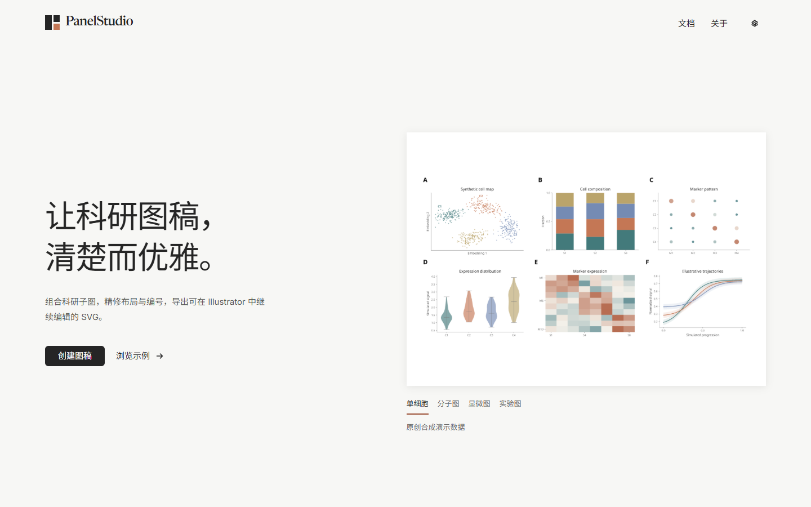
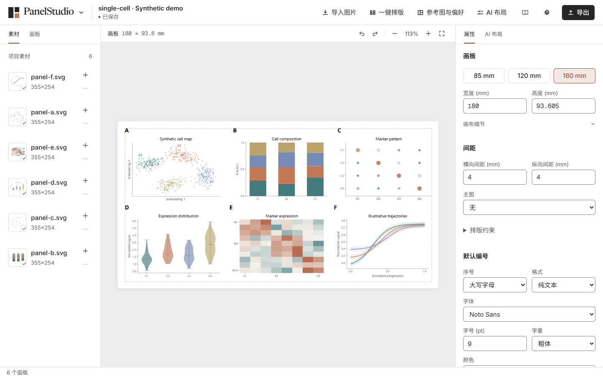
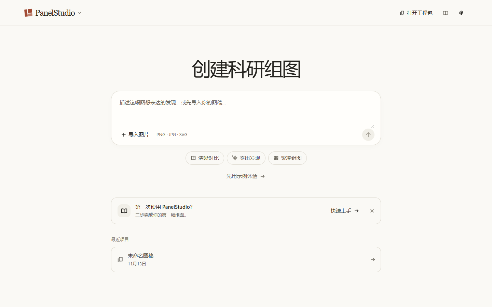
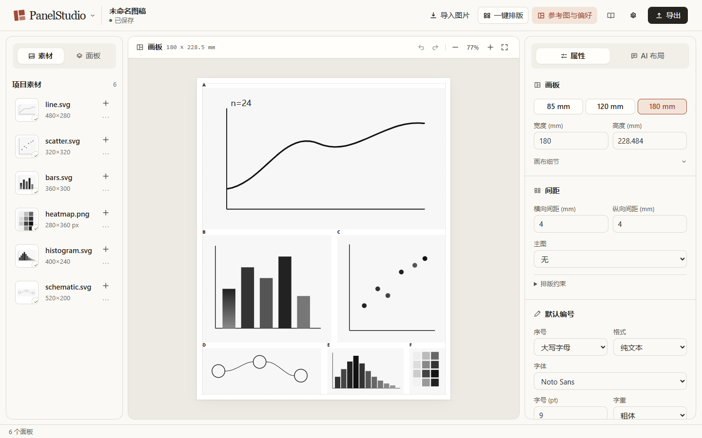

# Editorial Studio · 第二阶段交付与验收

2026-11-14。实现从用户指定的 `c3d15b44a3ad0afcd35aac74001c5cb9b9cac278` 创建独立分支 `design/editorial-studio`。保留该提交已有的首页输入、排版目标、参考图与偏好、内容排版、AI 连接和连续草案能力。后端 API、FigureDocument schema、数据库迁移、排版几何与导出内核没有随视觉改版重写。

## 直接查看

- [53.4 秒实际运行录像](demo/editorial-studio.webm)：真实浏览器操作，原创合成数据；没有调用外部模型。
- [完整首页](screenshots/editorial/home-complete.png)、[英文首页](screenshots/editorial/home-english.png)、[深色工作区](screenshots/editorial/editor-dark.png)、[手机工作区](screenshots/editorial/editor-mobile.png)。
- [候选排版](screenshots/editorial/arrange.png)、[AI 修改摘要](screenshots/editorial/refine.png)、[导出窗口](screenshots/editorial/export.png)。AI 截图来自正常 HTTP 接口上的本地受控测试模型，不代表真实服务商结果。
- [设计系统](editorial-design-system.md)、[可导入的四类示例与生成方法](../examples/showcase/)、[品牌图形](../apps/web/public/brand/mark.svg)、[GitHub 社交预览图](screenshots/editorial/social-preview.png)。





## 实现范围

| 项目 | 实际行为 |
| --- | --- |
| 首页 A → B | 编辑式首屏，四张真实导出轮播，八阶段编辑回放，Arrange / Refine / Export，最近项目与示例入口 |
| 字号 | 页面与控件只使用 13、15、24、56 px 四档及相应 rem；图稿内文字保持原始科学文档字号 |
| 动画 | 自动播放一轮后停止；手动阶段切换、暂停、原稿/精修比较；离开可见区域暂停；reduced-motion 保留手动切换 |
| 原创素材 | 单细胞、分子、显微、实验四类合成图；真实导入、排版、平移事务、SVG/PNG/工程包导出和重开校验 |
| 路由 | `/` 首页，`/app` 继续项目或旧创建流程，`/app/:projectId` 深链接；支持刷新、返回和前进 |
| 状态保留 | 首页切换保留相机、选择、页签和未发送输入；离开前等待导入/保存，阻止未完成裁剪或失败草稿丢失 |
| 左侧栏 | 素材与面板页签、轻量缩略图列表、完整文件名提示、原有导入诊断、排序、锁定与图层功能 |
| 中央画布 | 纯白纸张独立于 UI 主题，直接拖动与缩放；候选移到右侧，不挤压画布高度 |
| 自适应属性 | 单图几何与编号、多选排版与统一字号/字体/字重/颜色、无选择时画板与默认样式、预览文档只读 |
| AI 精修 | 冻结作用范围、结构化修改、变化前后数值、原稿/草案比较、应用/放弃/继续调整、折叠历史；保留多轮、澄清、取消、过期保护 |
| 导出 | SVG / PNG / 工程包单格式选项；明确已保存修订号，提醒未应用草案；字体下载、诊断、再次下载 |
| 项目库 | 当前项目恢复、完整项目搜索、分批展示、软删除与回收站恢复；最近项目按更新时间排序 |
| 可访问性 | Tabs 键盘导航、对话框焦点管理、字段名称与禁用原因、四档字号和文本缩放、手机抽屉与触控入口 |

## 前后对照

左列是 `c3d15b4` 已有的实际产品截图，直接从该提交取出；右列来自本次运行。两套图稿内容不同，用于比较界面结构，不作为图稿几何的像素级差分证据。

| 基线 | 本次实现 |
| --- | --- |
|  |  |
|  |  |

## 回归与环境

实际环境为 Windows、Node.js 24.15.0、pnpm 10.33.4、Playwright 1.65.0 和本机 Edge。所有回归使用独立数据库；没有接入用户原有项目目录或付费模型。

- 全仓类型检查通过，九个包/应用均完成。见[类型检查日志](acceptance-editorial/typecheck.log)。
- **179 项逻辑测试通过**：contracts 33、core 19、text metrics 3、layout 30、SVG 7、AI 13、UI 3、web 17、server 54。见[日志](acceptance-editorial/unit.log)。
- **50 项浏览器回归全部通过**，随后 AI 操作按钮位置调整另有 **10 项复测通过**。检查覆盖原有导入、排版、拖动、缩放、裁剪、编号、分组/排序、撤销/重做、连续 AI、设置、参考图、出版目标、导出与恢复，并增加首页和路由检查。首页原始子图进入画板的阶段补充检查 **1/1 通过**，见[回放补充日志](acceptance-editorial/replay-followup.log)。结果见[完整浏览器日志](acceptance-editorial/e2e.log)与[AI 补充日志](acceptance-editorial/ai-followup.log)。
- 1440×900、1280×800、1024×768、390×844、320×740，中文/英文、浅色/深色、减少动态效果的实际页面均进行字号与横向溢出检查。
- **真实浏览器 200% 缩放通过**。独立 Edge 窗口外宽保持 1440，内容宽从 1406 CSS px 变为 703，DPR 从 1 变为 2。首页、编辑器和导出窗口横向溢出均为 0；两个缩放级别都完成真实 SVG 下载。见[测量](acceptance-editorial/zoom-results.json)、[200% 编辑器](screenshots/editorial/editor-zoom-2.png)和[200% 导出](screenshots/editorial/export-zoom-2.png)。脚本通过 Chromium 的 [settingsPrivate 缩放接口](https://chromium.googlesource.com/chromium/src/+/main/chrome/common/extensions/api/settings_private.idl)设置浏览器缩放，不以 CSS zoom 或设备像素比模拟。
- 生产构建通过，九个字体文件、示例与品牌资源均在输出目录中。Vite 仍报告约 1.17 MB 的单个主 JS 包（gzip 约 399 KB）以及四个 Noto URL 的运行时解析提示。字体由现有构建插件复制；本次没有实施代码拆包性能工程。见[构建日志](acceptance-editorial/build.log)。

基线原有浏览器用例并非全部通过：实测曾有重复导入错误文件名定位、过期侧栏宽度预期与 AI 返回后的面板状态问题。本次按真实新流程迁移了入口和断言，保留功能性断言。测试过程中有 Windows 原生进程以 `0xC0000409` 退出的中断记录；这些中断不计为通过，最终验收使用新的隔离运行。

## Illustrator：单独实机检查，尚有字体环境项

用当前代码重新导出五组样稿，在 Illustrator **30.7.0 / 114R** 中检查画板、剪切框、原生文字和路径、独立图块移动、透明度、渐变、保存为 `.ai` 后重开。

**本次直接打开为 136/156 项通过。** 20 项失败均与编号字体/字重及重开后的字面保持有关：当前 Illustrator 将拉丁字面替换成 Noto Sans JP；中文粗体直接打开仍存在字面替换。几何、编号尺寸、原生对象编辑和其余持久化检查通过。见[原生报告](acceptance-editorial/illustrator-direct.json)。

使用随附编号还原工具时，中文样稿为 **31/31**；其余四组因当前实例找不到 `NotoSans-Regular` / `NotoSans-Bold`，在字体前置检查处停止，不能算作完成全部复测。见[还原报告](acceptance-editorial/illustrator-restored.json)。本次没有安装系统字体、关闭用户的 Illustrator 文档或覆盖历史验收。完整通过仍需要目标 Illustrator 实例载入所需字体后复测；2026-11-10 的历史通过结果不能替代这次结果。

首页四类示例是原创合成演示；原生五组验收采用独立兼容性样稿。没有声称四类示例经过逐张人工签收，也没有把自动化 IME 事件测试当作人工输入法候选窗体验。

## 本地复现和交付边界

正常启动方式见 README。需要独立评审数据时：

```powershell
node scripts/local-preview.mjs .panelstudio/editorial-preview
# 默认 http://127.0.0.1:5283，API 4341；不会读取 ~/.panelstudio

pnpm --filter './packages/*' --filter './apps/*' typecheck
pnpm --filter './packages/*' --filter './apps/*' --if-present test
pnpm exec playwright test -c apps/web/playwright.config.ts
pnpm --filter @panelstudio/web build
```

使用 Edge 可设 `PANELSTUDIO_E2E_CHANNEL=msedge`；端口可用 `PANELSTUDIO_E2E_API_PORT` / `PANELSTUDIO_E2E_WEB_PORT` 指定。录像脚本需要 `pnpm exec playwright install ffmpeg`。可用 `scripts/record-editorial.mjs`、`scripts/capture-editorial-assets.mjs` 和 `scripts/check-browser-zoom.mjs` 重新采集运行材料；这些脚本只访问专用预览服务。

交付为独立 Git 分支与待评审 PR，未合并主分支，未部署远程站点。首页文字先保留本版供用户直接删减；四档字号限制已经执行。最终审美取舍仍由用户按实际页面指导。
