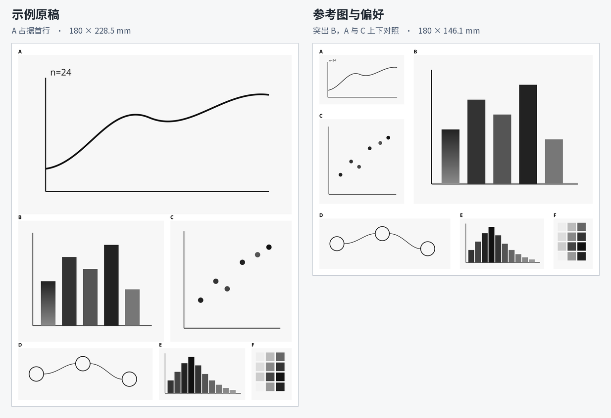

# 参考图与排版偏好

这份样稿用同一组六张素材展示两种阅读顺序。原稿由 A 占据首行。指定 B 为主图、A 与 C 上下对照后，B 的图框面积占六个图框总面积的比例从 19.8% 变为 52.4%。两个版本的画布宽度都是 180 mm。

## 在编辑器复现

1. 从项目菜单导入[六图原稿](../refinement-six/start.figurezip)，点工具栏的 **参考图与偏好**。
2. 选择[六区域参考轮廓](reference-outline.svg)，或使用期刊原图。样稿参考了 Marconato 等的 SpatialData Figure 1，A 和 C 在左侧上下排列，B 在右侧跨两行，D、E、F 在底部并列。参考轮廓只含位置和编号。[Nature Methods 原图](https://www.nature.com/articles/s41592-024-02212-x/figures/1)
3. 确认六个区域对应 A–F，输入 **突出 B，A 和 C 上下排列，留白多一点**。表单会显示 B 为主图、A/C 上下对比、间距 6 mm。展开 **手动设置** 可调整这些选项。
4. 点 **生成候选**，预览 **参考行列结构**，再点 **应用此版**。一次撤销可以回到原稿。也可以直接打开[排好版的工程](guided.figurezip)、[可编辑 SVG](guided.svg) 或 [Illustrator 原生文件](guided.ai)。

## 可以指定什么

参考图和偏好可单独使用或组合。PNG、JPEG、WebP 和 SVG 由浏览器读取，提交给排版引擎的是区域、面板对应关系和已确认选项。每个完整编组占一个区域。排版引擎按现有素材的裁剪比例和实际编号尺寸放置面板，检查最小尺寸、锁定、对齐约束、重叠和页边距。

- 有边框的图可按外框识别。无边框的图可以按留白尝试切分。两种识别都有结果时可切换。遇到公共图例、跨区箭头或嵌套小图，可以重画、增删或交换区域。
- “紧凑”对应 2 mm，“留白多一点”对应 6 mm。也可以输入“间距 3.5 mm”。画布方向支持横版、竖版和近方形，固定画布仍使用已有尺寸。
- 主图、希望相邻的两个面板及其方向都可指定。无法识别的措辞会保留供确认。候选需要满足已选择的条件，确认应用后才更新稿件。

## 实测

上传期刊原图后，编辑器自动找到了对应的六个区域。生成候选、应用、撤销和重做均通过浏览器操作核对。导出的工程在新的项目库中重新打开，六个面板、编号、裁剪及 24 个素材文件得到保留。

在先前研究的八张组图上，将当前工程的单元数设为相应参考图的面板数后，默认识别框中有 **25/41** 个与人工框的一对一交并比达到 0.5，**3/8** 张图的每个面板都匹配。这个数字衡量区域识别，个人对候选的美观评价仍需单独收集。[逐图结果与验收数据](acceptance.json)

本机 Illustrator 30.7.0（114R）首次将六个拉丁编号映射到 Noto Sans JP Bold。刷新当前用户的仓库字体后，直接打开 SVG、保存并重新打开交付的原生 AI，通过 **67/67** 项检查，包括六个独立面板组、可编辑文字、字体、字号、编号基线、裁剪框、画板、矢量路径与独立栅格图。[实机记录](acceptance.json)
